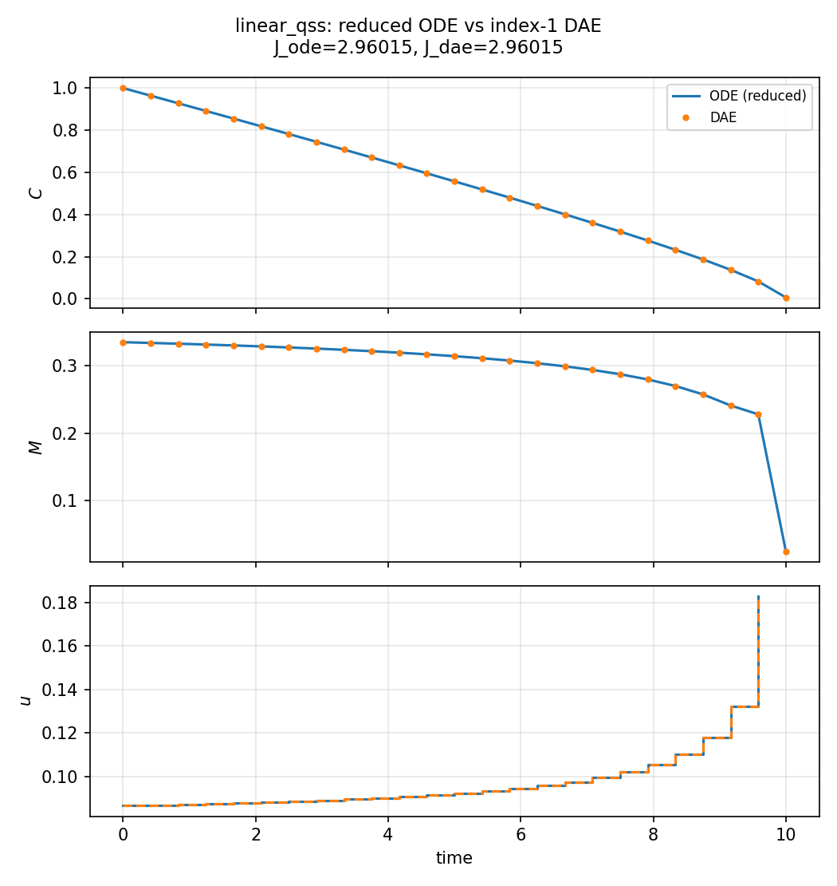
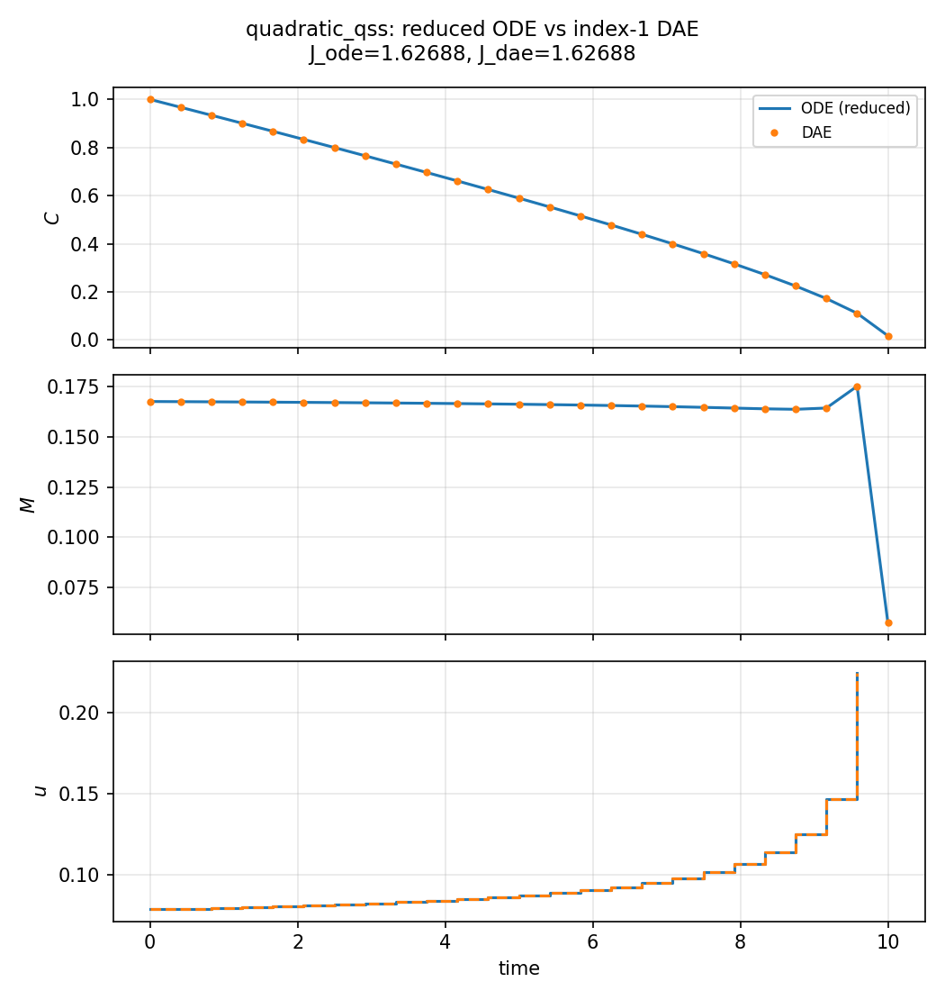

# Quasi-steady microbes (`algebraic_qss`)

**Question.** How can fast microbial biomass be closed without a stiff
biomass ODE — and why does that matter for an OCP?

## Why this exists

Litter carbon \(C\) is slow (days to years). Microbial biomass \(M\) is
fast (hours). Writing \(\dot M = \text{growth}-\text{death}\) forces
tiny time steps or a stiff integrator, and in collocation it forces
extra state nodes that barely move except at the start.

The quasi-steady hypothesis is: **growth = death at every instant**.
Then \(M\) is not a differential state. It is an unknown that sits on
the manifold \(g(C,M,u)=0\). The OCP still chooses uptake \(u(t)\); it
just does not choose an initial \(M(0)\).

That is the value: the same optimality question (how to use a finite
substrate) without pretending biomass is as slow as litter.

## Formulation

| Symbol | Role | Meaning |
|---|---|---|
| \(C(t)\) | differential state | substrate (slow) |
| \(M(t)\) | **algebraic** unknown | microbial biomass (fast) |
| \(u(t)\) | control | uptake |

**Differential dynamics.** \(\dot C=-u\).

**Algebraic closure.** \(0=g(C,M,u)\) (growth = death).

**Objective.** \(\max\int_0^{T} M\,\mathrm{d}t\), \(T=10\) fixed.

**Constraints.** \(C(0)=1\), \(C\ge 0\), \(M\ge 0\),
\(0\le u\le u_{\max}=0.5\). \(M\) has **no** initial condition.

In `eco_opt`: `System(algebraics=1)`; the model returns `(dx, dz, y)`
and `dz` is the residual \(g\).

### Linear death (`linear_qss.py`)

\[
g=(e_{\max}-r u)\,u\,\frac{C}{K+C}-d M.
\]

Linear in \(M\), so there is a unique formula

\[
M=\frac{(e_{\max}-r u)\,u}{d}\frac{C}{K+C}.
\]

You may **substitute** that into \(J\) and \(\dot C\) (ordinary ODE) or
**keep** \(M\) and \(0=g\) (DAE). Both must give the same \(J\),
\(C(t)\), and \(u(t)\). That pair is the check that the algebraic
transcription is not a different problem.

### Quadratic death (`quadratic_qss.py`)

Death is \(d M + c M^2\), so \(g=0\) is a quadratic. The physical root
is the plus branch of a square root; the minus root is junk. Here you
do **not** put `sqrt` in \(f\): write \(0=g\) and \(M\ge 0\), and let
the solver stay on the physical branch.

## What was done

Radau collocation, degree 3. ODE vs DAE on the linear closure; DAE
only on the quadratic closure.

## What we found

Linear ODE and DAE objectives agree to about \(10^{-4}\). Trajectories
of \(C\) and \(u\) overlie. The quadratic case has no explicit \(M\)
and is solved only as a DAE; \(M\ge 0\) selects the physical root.





## Interpretation

If a pool is fast enough that you would never integrate it in a
forward model (you would set growth = death and move on), it should
not become a stiff ODE just because you posed an OCP. An algebraic
state is that modeling choice, made visible to collocation. The linear
pair (ODE vs DAE) is how you **trust** the implementation: same
hypothesis, two writings, same \(u^*(t)\).

## Public API

ODE vs DAE of the same hypothesis (`examples/algebraic_qss/linear_qss.py`):

```python
import eco_opt
from eco_opt import Namespace


def ode_model(t, x, u):
    C, uptake = x[0], u[0]
    M = biomass(C, uptake)
    return -uptake, Namespace(C=C, M=M, u=uptake)


def dae_model(t, x, u, z):
    C, uptake, M = x[0], u[0], z[0]
    g = growth(C, uptake) - D * M
    return -uptake, g, Namespace(C=C, M=M, u=uptake)


ode = eco_opt.System(states=1, controls=1, model=ode_model)
dae = eco_opt.System(states=1, controls=1, algebraics=1, model=dae_model)
```

## Run and tests

```bash
cd examples/algebraic_qss
python linear_qss.py
python quadratic_qss.py
python plot_algebraic_qss.py
python -m pytest ../../tests/test_algebraics.py -q
```
