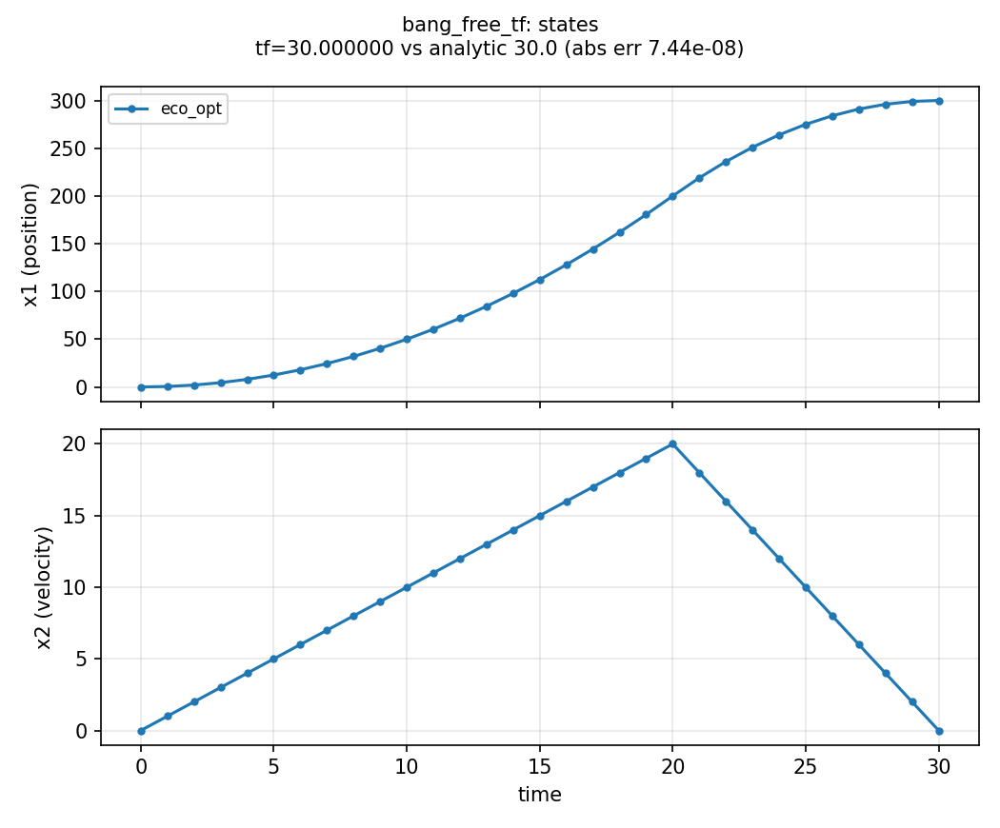
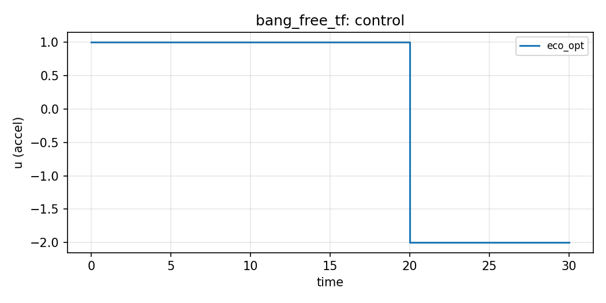

# Bang-bang free horizon (`bang_free_tf`)

**Question.** How fast can a double integrator move from rest to a
distant rest when the horizon is free and thrust bounds are asymmetric?

## Formulation

| Symbol | Role | Meaning |
|---|---|---|
| \(x,v\) | states | position, velocity |
| \(u\) | control | acceleration |

**Dynamics.** \(\dot x=v\), \(\dot v=u\).

**Objective.** \(\min T\).

**Constraints.** \(-2\le u\le 1\), \((x,v)(0)=(0,0)\),
\((x,v)(T)=(300,0)\), \(T\ge 0\).

**Horizon.** Free.

Analytic: \(u=+1\) on \([0,20]\), \(u=-2\) on \([20,30]\), \(T^*=30\).

## What was done

`ocp.min(t_f(t))` with a free upper bound on \(T\). Legendre
collocation.

## What we found

Numerical \(T\) agrees with \(30\) to about 1%. States meet the
terminal rest condition.





## Interpretation

Unequal bounds on \(u\) shift the switch away from the midpoint. The
horizon is a decision: the problem is finished when the target is
reached, not at a prescribed clock time.

## Public API

Bare `dx`, no `Namespace` (`examples/bang_free_tf/bang_free_tf.py`):

```python
import eco_opt


def bang_model(t, x, u):
    return [x[1], u[0]]


sys = eco_opt.System(states=2, controls=1, model=bang_model)
ocp = eco_opt.Ocp()
ocp.min(eco_opt.t_f(sys.t))
ocp.st(system=sys, constraints=[...])
```

## Run and tests

```bash
cd examples/bang_free_tf
python bang_free_tf.py
python plot_bang_free_tf.py
python -m pytest ../../tests/test_bang_free_tf.py -q
```

## References

Transcription of the Yop example
[Linear problem with bang-bang control](https://www.yoptimization.com/bangFreeTf).
The problem is the same; the text and code here are ours.
