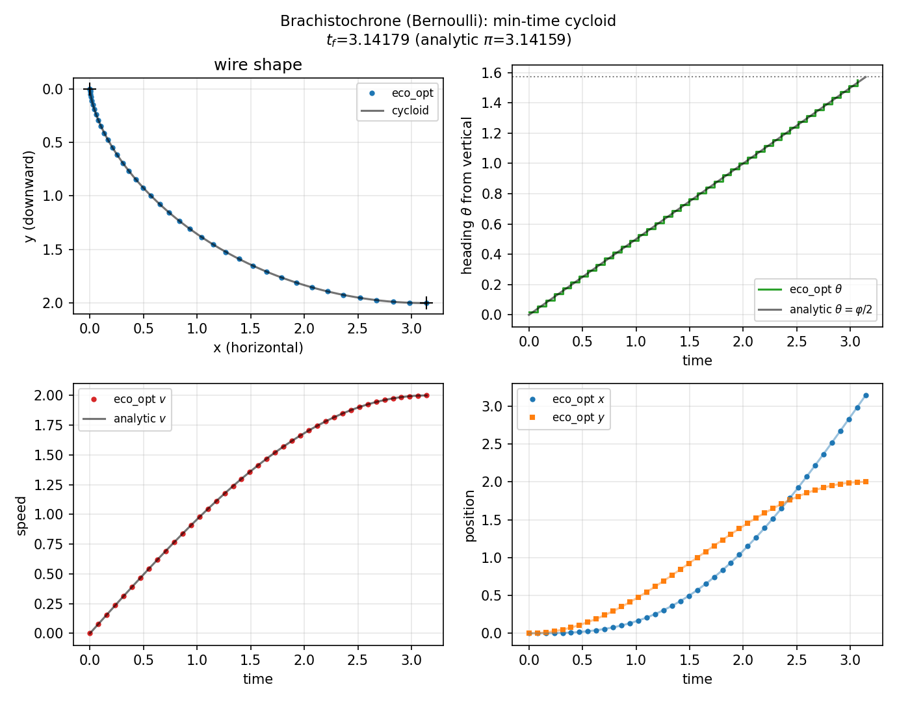

# Brachistochrone (`brachistochrone`)

**Question.** Which wire from the origin to a lower point minimises
travel time under gravity?

## Formulation

States \((x,y,v)\): horizontal and vertical position, speed. Control:
path angle (or equivalent). Gravity \(g\), no friction.

**Objective.** \(\min T\). **Horizon.** Free.

Endpoint \((x_f,y_f)=(\pi,2)\) in the scaled units of the example.
The minimiser is a cycloid with \(T^*=\pi\).

## What was done

Free \(t_f\), nonlinear kinematics, Legendre collocation. Analytic
cycloid helpers are in the same folder.

## What we found

Numerical \(T\) and \(J\) match \(\pi\) to about \(2\times 10^{-3}\).
Endpoints match \((\pi,2)\).



## Interpretation

The first named calculus-of-variations problem is still the cleanest
free-horizon nonlinear-kinematics test. It is not an ecological model;
it gates free \(T\) on a curved state manifold.

## Public API

Full script: `examples/brachistochrone/brachistochrone.py`.

```python
import casadi as cs
import eco_opt
from eco_opt import Namespace


def brachistochrone_model(t, x, u, g=1.0):
    xpos, ypos, speed, theta = x[0], x[1], x[2], u[0]
    y = Namespace(x=xpos, y=ypos, v=speed, theta=theta)
    return [
        speed * cs.sin(theta),
        speed * cs.cos(theta),
        g * cs.cos(theta),
    ], y


sys = eco_opt.System(states=3, controls=1, model=brachistochrone_model)
ocp = eco_opt.Ocp()
ocp.min(eco_opt.t_f(sys.t))
ocp.st(system=sys, constraints=[...])
```

## Run and tests

```bash
cd examples/brachistochrone
python brachistochrone.py
python plot_brachistochrone.py
python -m pytest ../../tests/test_brachistochrone.py -q
```

## References

Bernoulli (1696).
