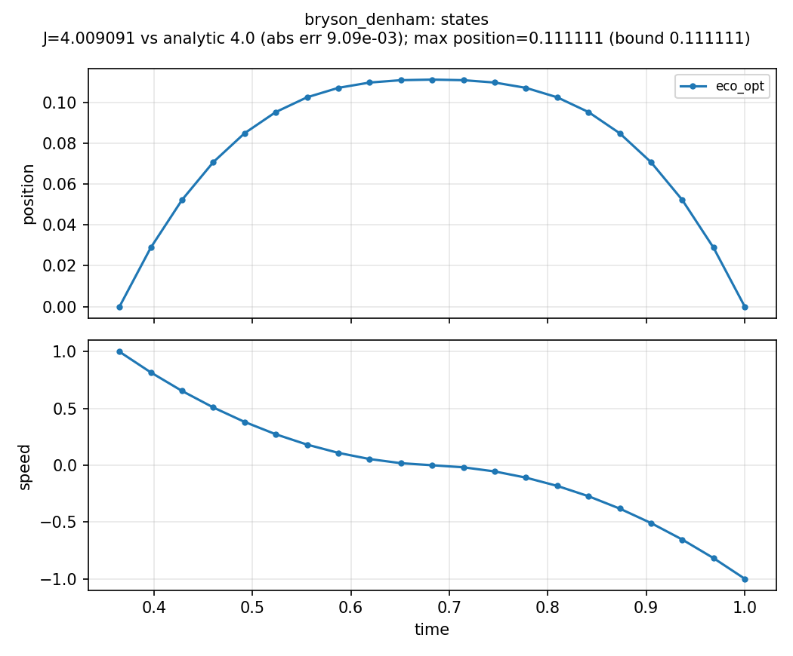
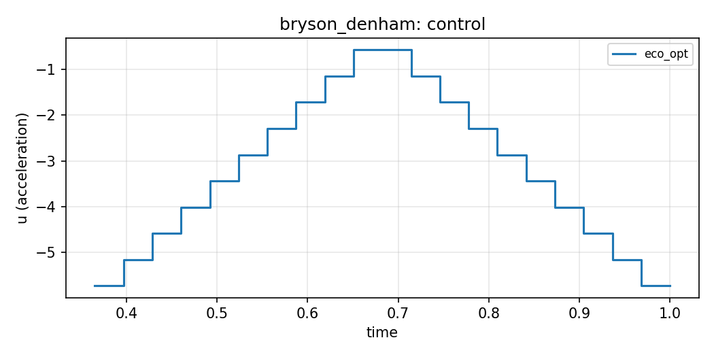

# Bryson–Denham (`bryson_denham`)

**Question.** Minimum-energy double integrator whose trajectory must
not exceed a path bound on position.

## Formulation

**Dynamics.** \(\dot x=v\), \(\dot v=a\).

**Objective.**

\[
\min \int_0^1 \tfrac12 a^2\,\mathrm{d}t.
\]

**Constraints.** \(x(0)=0\), \(v(0)=1\), \(x(1)=0\), \(v(1)=-1\),
and the path inequality \(x(t)\le 1/9\).

**Horizon.** Fixed, \(T=1\).

Closed form: the trajectory kisses \(x=1/9\) on an interior arc and
\(J^*=4\).

## What was done

Path bound as a constraint on the named position signal. The bound can
be retuned with `set_constraints` / `optimize(warm_start=False)`
without rebuilding the mesh. See [Build and optimize](../build-optimize.md).

## What we found

\(J\) matches \(4\) to a few parts in \(10^3\). Peak position sits on
\(1/9\). Terminal state matches the specified rest-reversal.





## Interpretation

A path constraint is a physiological-style limit: the process may not
leave an admissible set at **any** time, not only at the endpoint.
Collocation enforces that at the nodes.

## Public API

Full script: `examples/bryson_denham/bryson_denham.py`.
The path bound is the one-sided form `(ub, ">=", expr)`
([Constraints and time](../constraints-and-time.md)).

```python
import eco_opt
from eco_opt import Namespace


def trolley_model(t, x, u):
    position, speed, acceleration = x[0], x[1], u[0]
    y = Namespace(position=position, speed=speed, acceleration=acceleration)
    return [speed, acceleration], y


sys = eco_opt.System(states=2, controls=1, model=trolley_model)
ocp = eco_opt.Ocp()
ocp.min([0.5 * sys.y.acceleration ** 2])
ocp.st(
    system=sys,
    constraints=[
        (0, "==", eco_opt.t_0(sys.t)),
        (0, "==", eco_opt.t_0(sys.y.position)),
        (1, "==", eco_opt.t_0(sys.y.speed)),
        (1, "==", eco_opt.t_f(sys.t)),
        (0, "==", eco_opt.t_f(sys.y.position)),
        (-1, "==", eco_opt.t_f(sys.y.speed)),
        (1.0 / 9.0, ">=", sys.y.position),
    ],
)
sol = ocp.solve(control_intervals=20, polynomial_degree=5, tf_guess=1.0)
```

## Run and tests

```bash
cd examples/bryson_denham
python bryson_denham.py
python plot_bryson_denham.py
python -m pytest ../../tests/test_bryson_denham.py -q
```

## References

Bryson and Ho, *Applied Optimal Control* (1975). Also shipped with Yop:
[Bryson–Denham](https://www.yoptimization.com/brysonDenham).
The text and code here are ours.

!!! warning "Not validated against published figures"
    Numerics are checked against the closed-form cost \(J^*=4\), not
    against figures from Bryson and Ho.
