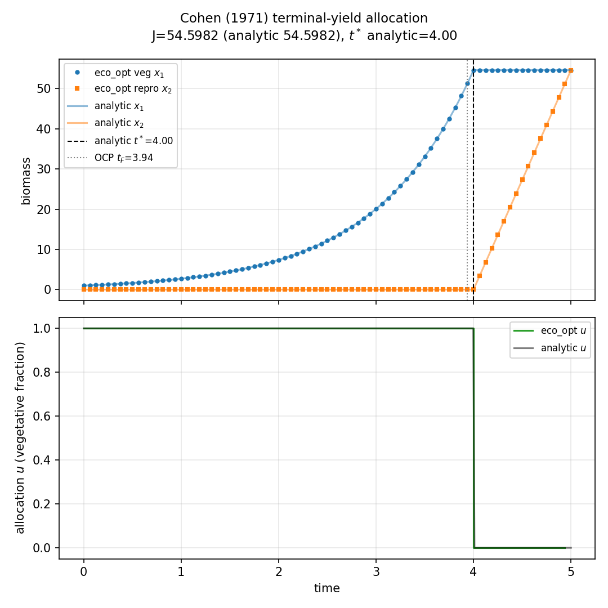
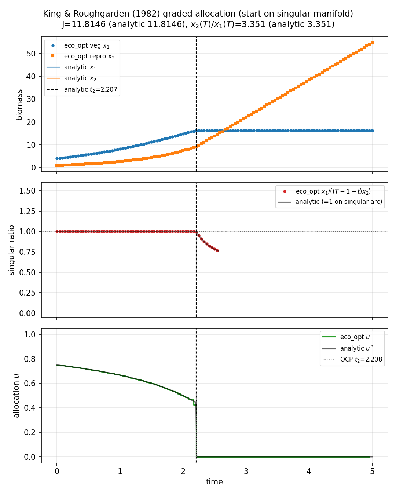

# Cohen and King allocation (`cohen_king_roughgarden`)

**Question.** For an annual plant (one vegetative compartment, one
reproductive compartment), how should allocation switch through a
fixed season?

Here **plant** means that annual-plant model.

## Formulation

| Symbol | Role | Meaning |
|---|---|---|
| \(x_1(t)\) | state | vegetative biomass |
| \(x_2(t)\) | state | reproductive biomass |
| \(u(t)\in[0,1]\) | control | fraction of production kept vegetative |

**Dynamics** (relative growth rate 1 in these units).

\[
\dot x_1 = u\,x_1,
\qquad
\dot x_2 = (1-u)\,x_1.
\]

**Objectives** (same \(f\), two hypotheses).

\[
\text{Cohen:}\quad \max x_2(T);
\qquad
\text{King:}\quad \max\int_0^T \ln x_2(t)\,\mathrm{d}t.
\]

**Constraints.** \(x_1(0)=X_{10}>0\), \(x_2(0)=0\), \(0\le u\le 1\).
**Horizon.** Fixed season \(T\).

## What was done

One collocation grid; \(u(t)\) free in \([0,1]\). Cohen uses a Mayer
term \(t_f(x_2)\); King uses a running log payoff.

## What we found

Cohen is bang–bang: \(u^*=1\) on \([0,T-1]\), then \(u^*=0\). For
defaults \(T=5\), \(X_{10}=1\), switch at \(4\) and \(x_2(T)=e^{4}\).
King is bang–singular–bang: a mixed-growth arc with
\(x_1=(T-1-t)x_2\). The OCP recovers both closed forms.





## Interpretation

The same plant ODE yields different schedules when \(J\) changes:
a single terminal harvest (Cohen) versus a running reproductive
payoff (King). The switch is not inserted in \(f\); it is implied by
\(J\) and \(0\le u\le 1\).

## Run and tests

```bash
cd examples/cohen_king_roughgarden
python cohen_terminal_yield.py
python king_singular_allocation.py
python -m pytest ../../tests/test_cohen_king_roughgarden.py -q
```

## References

Cohen (1971), maximising terminal seed yield. King and Roughgarden
(1982), graded allocation with a log running payoff.

!!! warning "Not validated against published figures"
    Numerics are checked against the papers’ **closed-form** controls
    and yields, not against figures from those papers.
