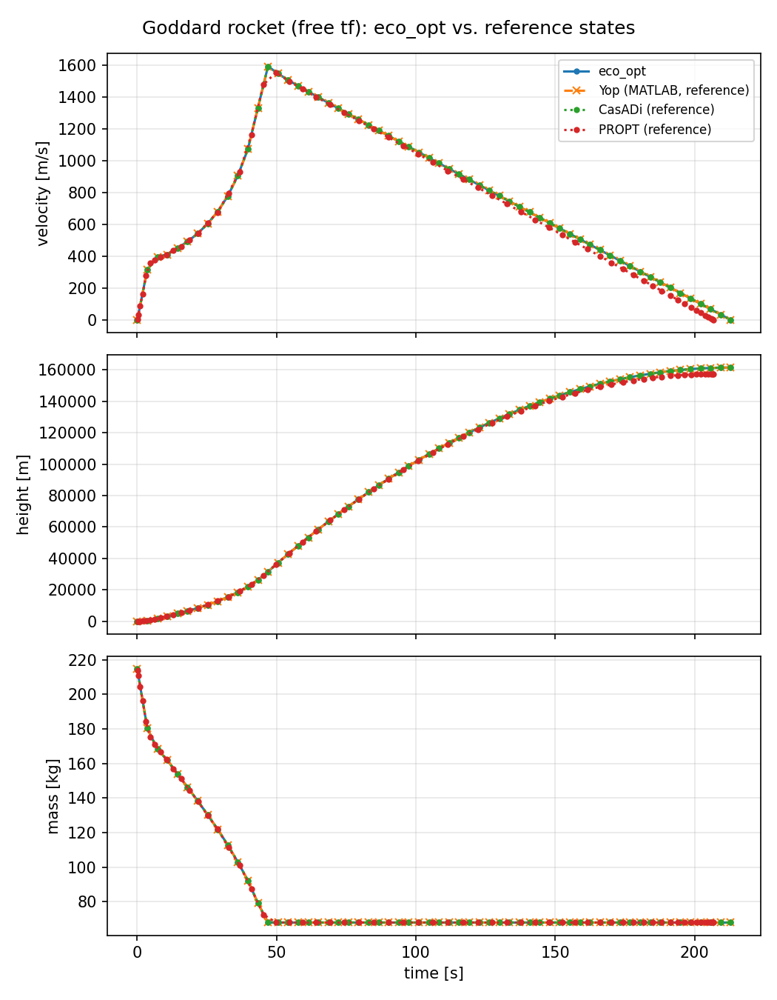
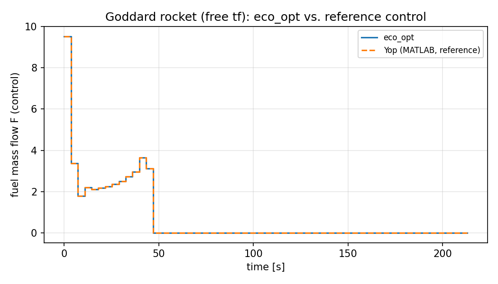

# Goddard, dimensional (`goddard_benchmark`)

**Question.** What thrust history maximises final altitude of a
vertical rocket when burnout time is free?

This is a **transcription check**, not an ecological model. It is the
problem used in [First solve](../first-solve.md).

## Formulation

| Symbol | Role | Meaning |
|---|---|---|
| \(v,h,m\) | states | velocity, altitude, mass |
| \(F\) | control | fuel mass-flow |

**Dynamics.**

\[
\dot v=\frac{F c-D(h)\,v|v|}{m}-g(h),\qquad
\dot h=v,\qquad
\dot m=-F,
\]

with exponential drag and inverse-square gravity (SI constants as in
the archived Yop run).

**Objective.** \(\max h(T)\). **Horizon.** Free.

**Constraints.** \(v(0)=h(0)=0\), \(m(0)=214.839\),
\(m(T)\ge 67.9833\), \(0\le F\le 9.525515\).

## What was done

Declared the same way as the ecological examples. Compared to
`work/goddard_benchmark/yop_goddard.mat` (59 intervals, degree 5,
Legendre).

## What we found

Altitude and \(T\) agree with the archive to relative errors on the
order of \(10^{-14}\). Control shows bang–singular–coast.





## Interpretation

Before ecological trajectories are trusted, free time, bounds, and
collocation are checked on a problem with an independent reference.
Agreement here is about the transcriber, not about rockets in ecology.

## Run and tests

```bash
cd examples/goddard_benchmark
python goddard_benchmark.py
python -m pytest ../../tests/test_goddard_benchmark.py -q
```

## References

Classic Goddard problem. Yop pages:
[free \(t_f\)](https://www.yoptimization.com/goddardRocketFreeTf),
[overview](https://www.yoptimization.com/goddardRocket).
The text and code here are ours.
