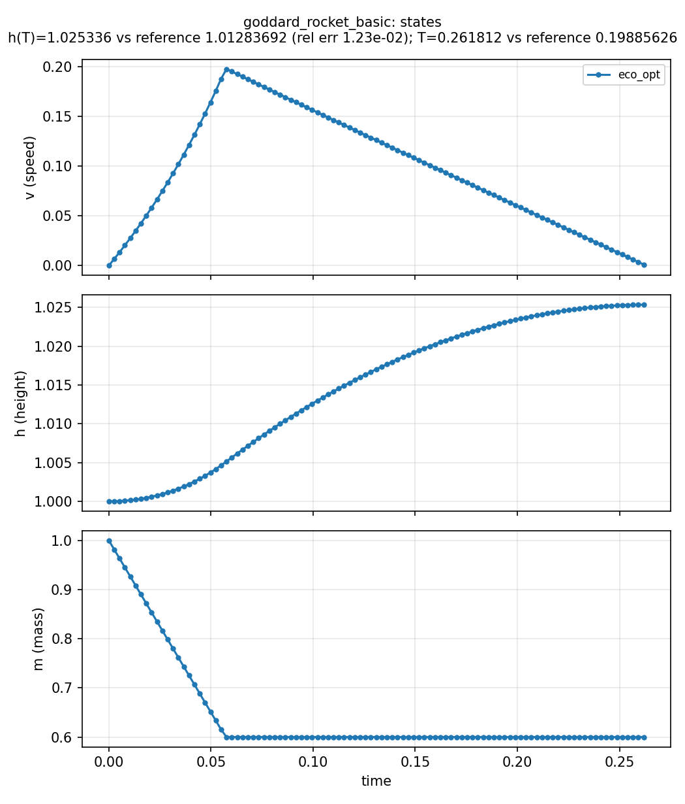
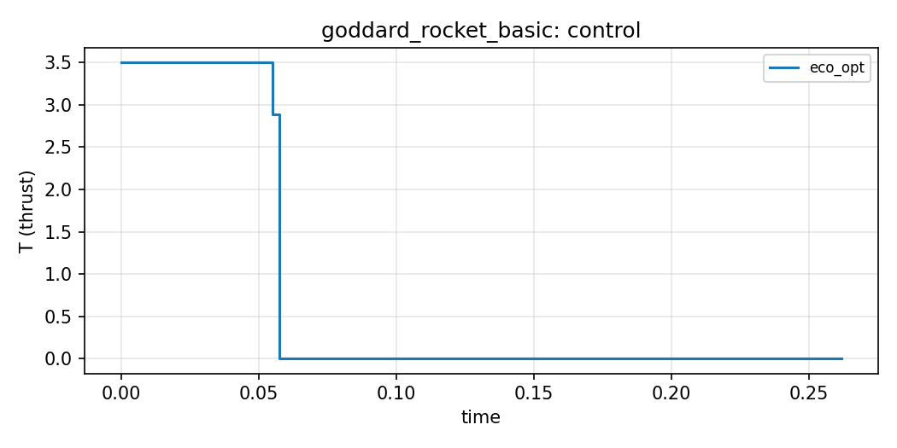

# Goddard, nondimensional (`goddard_rocket_basic`)

**Question.** Same ascent problem in nondimensional variables.

Transcription check, not ecology.

## Formulation

Maximise final altitude, free \(T\). Constants \(m_0=1\), \(m_f=0.6\),
\(h_0=1\), \(g_0=1\), \(D_0=310\), \(c=0.5\), \(\beta=500\),
\(T_{\max}=3.5\). Distinct from the dimensional archive in
`goddard_benchmark`.

**Objective.** \(\max h(T)\). **Horizon.** Free. Thrust and mass
bounds.

## What was done

Nondimensional `System`; free \(t_f\); height compared loosely to the
literature BVP value (drag-law offset vs some COPS listings). This
transcription's \(T\) is not the indirect-BVP \(0.199\).

## What we found

A bang–singular–coast thrust; altitude slightly above 1, within a few
percent of the BVP height. Final time is the transcription's own \(T\)
(drag-law / piecewise-constant \(u\) / mesh), not the BVP \(0.199\).
Tests assert height with a few-percent tolerance plus mesh refinement;
they do not assert \(T\) against \(0.199\).





## Interpretation

A second scaling of Goddard is useful as a mesh gate. It is not a
second ecological application.

## Public API

Skeleton of `examples/goddard_rocket_basic/goddard_rocket_basic.py`:

```python
import eco_opt
from eco_opt import Namespace


def goddard_basic_model(t, x, u):
    v, h, m, T = x[0], x[1], x[2], u[0]
    ...
    y = Namespace()
    y.rocket = Namespace(speed=v, height=h, fuelMass=m, thrust=T)
    return dx, y


sys = eco_opt.System(states=3, controls=1, model=goddard_basic_model)
ocp = eco_opt.Ocp()
ocp.max(eco_opt.t_f(sys.y.rocket.height))
ocp.st(system=sys, constraints=[...])
sol = ocp.solve(control_intervals=100, polynomial_degree=5, tf_guess=0.2)
```

## Run and tests

```bash
cd examples/goddard_rocket_basic
python goddard_rocket_basic.py
python plot_goddard_rocket_basic.py
python -m pytest ../../tests/test_goddard_rocket_basic.py -q
```

## References

Related Yop page:
[Basic rocket](https://www.yoptimization.com/goddardRocket).
The text and code here are ours.
