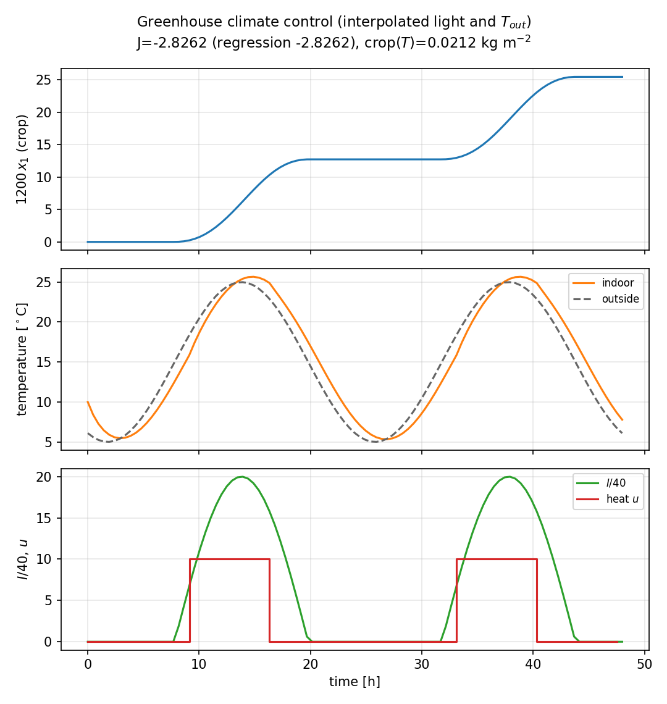

# Greenhouse climate (`greenhouse`)

**Question.** How should heating be scheduled when light and outside
temperature are known functions of time, not decisions?

## Formulation

| Symbol | Role | Meaning |
|---|---|---|
| \(x_1\) | state | crop dry weight |
| \(x_2\) | state | indoor temperature |
| \(u(t)\) | control | heating |
| \(I(t),\,T_{\mathrm{out}}(t)\) | forcing | light and outside temperature |

**Dynamics.**

\[
\dot x_1 = p_1 I(t)\, x_2,
\qquad
\dot x_2 = p_2\bigl(T_{\mathrm{out}}(t)-x_2\bigr)+p_3 u.
\]

\(I\) and \(T_{\mathrm{out}}\) are interpolants of a two-day table
(clipped daylight sinusoid). They are **not** NLP variables.

**Objective.**

\[
\min_u\; -p_5 x_1(T)+\int_0^{T} p_4 u\,\mathrm{d}t,
\qquad T=48\,\mathrm{h}.
\]

**Constraints.** \(x_1(0)=0\), \(x_2(0)=10\), \(0\le u\le 10\).
**Horizon.** Fixed.

## What was done

Forcing enters \(f\) as CasADi interpolants of \(t\). Heating is the
only control. Collocation on a 48 h horizon.

## What we found

Heating tracks the light/temperature cycle: on when the crop can use
heat, off at night when \(I=0\). Objective is regression-tracked (no
closed form).



## Interpretation

A prescribed environment is not a control. Putting weather in \(f\)
keeps the decision variable equal to what the grower actually chooses
(heating), and keeps the NLP dimension from growing with the weather
table.

## Run and tests

```bash
cd examples/greenhouse
python greenhouse.py
python -m pytest ../../tests/test_greenhouse.py -q
```

## References

van Straten, van Ooteghem, van Willigenburg and van Henten, *Optimal
Control of Greenhouse Cultivation*. Problem also shipped with Yop:
[Greenhouse](https://www.yoptimization.com/greenhouse).
The text and code here are ours.

!!! warning "Not validated against the book’s figures"
    The `eco_opt` trajectories are **not** checked against numerical
    results in van Straten et al. The example follows that formulation
    (tabulated weather as forcing).
