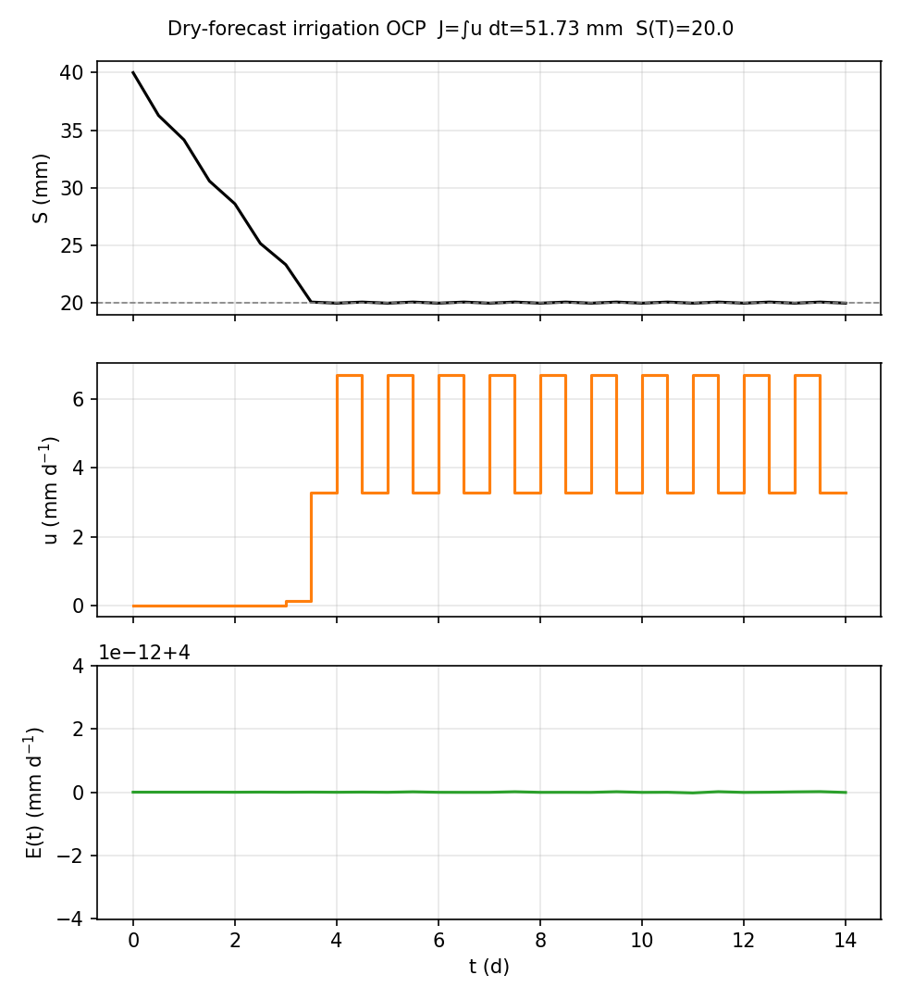
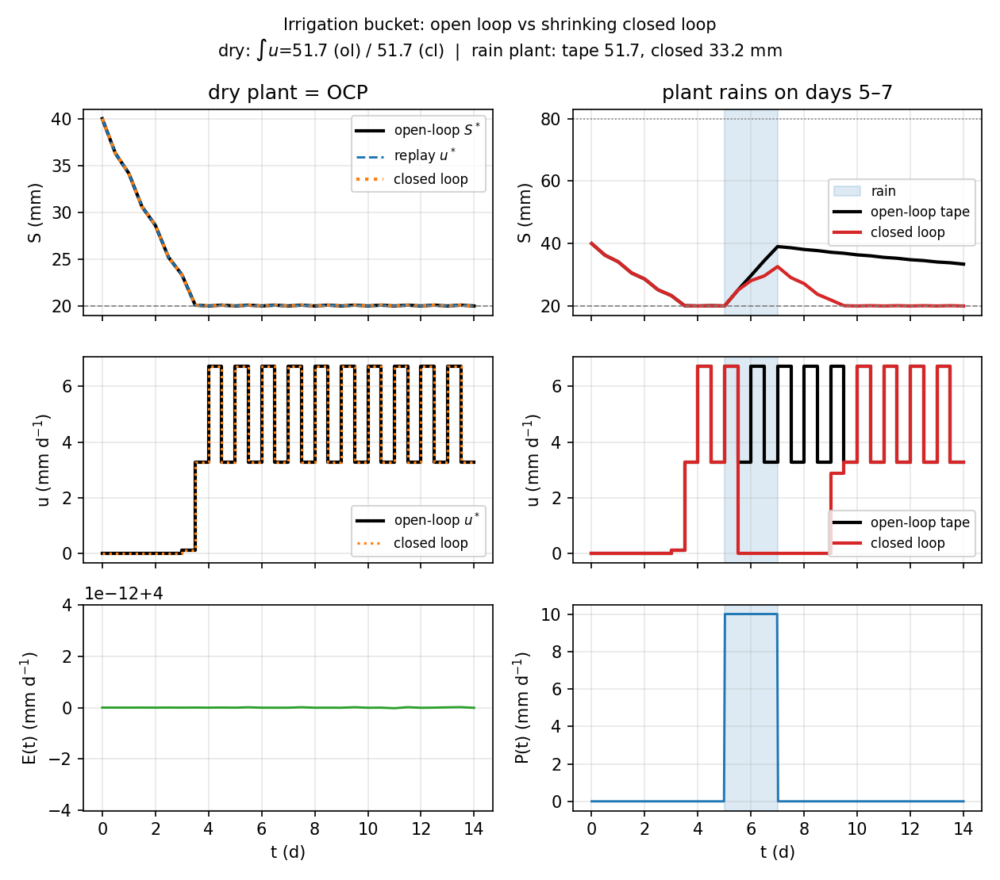

# Irrigation bucket (`irrigation_bucket`)

**Question.** How does an irrigation schedule designed for a dry
forecast compare with a closed loop that sees rain on the water store?

## Formulation

| Symbol | Role | Meaning |
|---|---|---|
| \(S(t)\) | state | root-zone storage (mm) |
| \(u(t)\) | control | irrigation (mm d\(^{-1}\)) |
| \(P(t)\) | forcing | rain (forecast vs realised) |
| \(E(t)\) | forcing | evapotranspiration |

**Dynamics.**

\[
\dot S = u + P(t) - E(t) - k S.
\]

**Objective.** \(\min \int_0^T u\,\mathrm{d}t\).

**Constraints.** \(S_{\min}\le S\le S_{\max}\). **Horizon.** Fixed.

The OCP forecast uses \(P\equiv 0\). Closed loop can apply rain to the
**simulated water store** while the controller still plans dry.
(`plant=` in the API means that simulated process, not vegetation.)

## What was done

The OCP is always the **dry forecast**: \(P\equiv 0\), sinusoidal ET,
minimize irrigation, keep \(S\) between field-capacity-style bounds.
That tape is the grower’s plan written on day 0.

Four integrations:

1. Open-loop NLP on the dry model (\(J^*\approx 51.7\,\mathrm{mm}\)).
2. `simulate` of that \(u^*\) on the **same** dry model — must reprint
   \(S^*(t)\).
3. Shrinking `closed_loop` on the dry model — must reprint \(u^*\)
   (nothing unexpected happens).
4. Unforecast rain on the **water store** in days 5–7: replay the dry
   tape vs re-solve from measured \(S\).

Rain is applied to storage \(S\), not to a vegetation canopy. The API
keyword `plant=` is the simulated process model (control-theory name).

## What we found

On the dry process, closed-loop \(u\) matches the open-loop tape (max
\(|u-u^*|\) small). After rain, the tape keeps irrigating as if the
soil were still dry and can pile \(S\) toward \(S_{\max}\). The closed
loop sees the wetter store and **cuts** irrigation (more than
\(5\,\mathrm{mm}\) less water in the test). Storage stays in bounds in
both cases; the difference is wasted pumping, not a bound violation.





## Interpretation

Open loop answers: *given this forecast, what irrigation is optimal?*
Closed loop answers: *given the store I measure now, what irrigation
is optimal for the remaining season?* Those coincide only if the
forecast was right. In ecology that is the difference between a
seasonal allocation plan and re-allocation after a rain, a litterfall
pulse, or a missed mineral-N flush. The OCP does not become a
different hypothesis; the **state** from which it is solved changes.

## Public API

Full script: `examples/irrigation_bucket/irrigation_bucket.py`.

```python
import eco_opt
from eco_opt import Namespace


def dry_model(t, x, u):
    S, irr = x[0], u[0]
    dS = irr - et(t) - K_DRAIN * S
    y = Namespace(S=S, u=irr)
    return dS, y


sys = eco_opt.System(states=1, controls=1, model=dry_model)
ocp = eco_opt.Ocp()
ocp.min([sys.y.u])
ocp.st(system=sys, constraints=[...])
sol = ocp.solve()
```

Closed loop on a rainy process: `ocp.closed_loop` in
`examples/irrigation_bucket/open_vs_closed.py`.

## Run and tests

```bash
cd examples/irrigation_bucket
python irrigation_bucket.py
python plot_irrigation_bucket.py
python open_vs_closed.py
python -m pytest ../../tests/test_irrigation_bucket.py -q
```

## References

Inspired by Shang, Chen, Stroock and You (2020). **Not** a
reproduction of their robust forecasts or water-saving number. The
`eco_opt` trajectories are **not** validated against that paper’s
figures.
