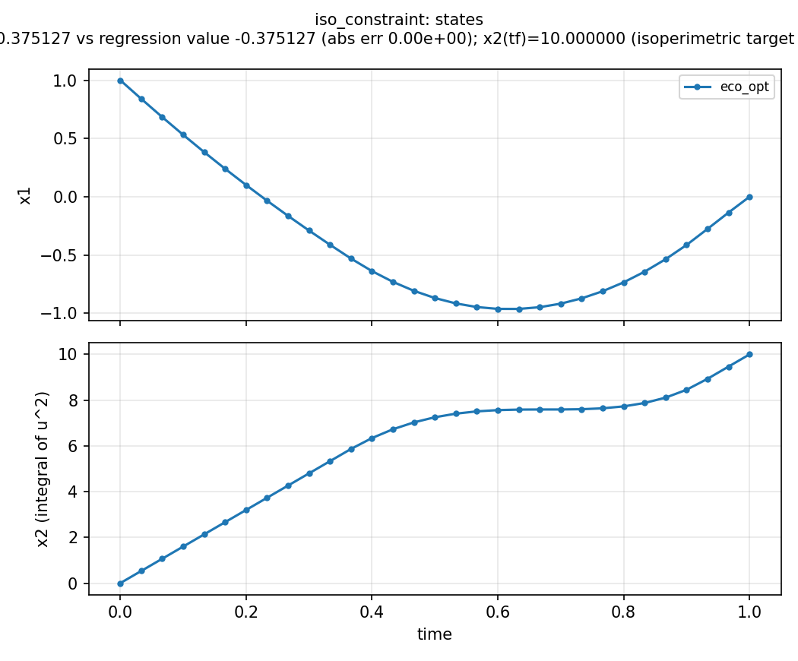
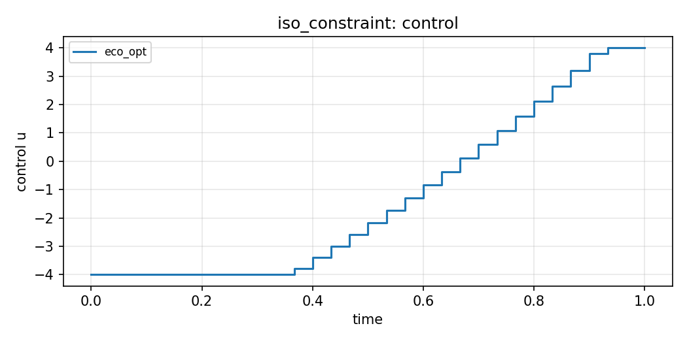

# Isoperimetric constraint (`iso_constraint`)

**Question.** How is a fixed integral of the control (a budget)
enforced?

## Formulation

**Dynamics.**

\[
\dot x_1=-\sin x_1+u,
\qquad
\dot x_2=u^2.
\]

**Objective.** \(\min\int_0^1 x_1\,\mathrm{d}t\).

**Constraints.** \(x_1(0)=1\), \(x_2(0)=0\), \(x_1(1)=0\),
\(x_2(1)=10\), \(-4\le u\le 4\). The condition \(x_2(1)=10\) is
\(\int_0^1 u^2\,\mathrm{d}t=10\) (an isoperimetric budget as an
auxiliary state; see [Constraints and time](../constraints-and-time.md)).

**Horizon.** Fixed, \(T=1\).

## What was done

An auxiliary integral state carries the budget. No `Namespace` tree
(bare `dx`).

## What we found

\(x_2(T)=10\) is met. Regression \(J^*\approx -0.375\).





## Interpretation

A cumulative C, N, water, or management budget is the same object: an
integral constraint, implemented as a terminal value of an extra
state. It is not a path bound on \(u(t)\) at each instant.

## Run and tests

```bash
cd examples/iso_constraint
python iso_constraint.py
python -m pytest ../../tests/test_iso_constraint.py -q
```

## References

Yop example
[Isoperimetric constraint problem](https://www.yoptimization.com/isoConstraint).
The text and code here are ours. No published numerical target for
this instance.
