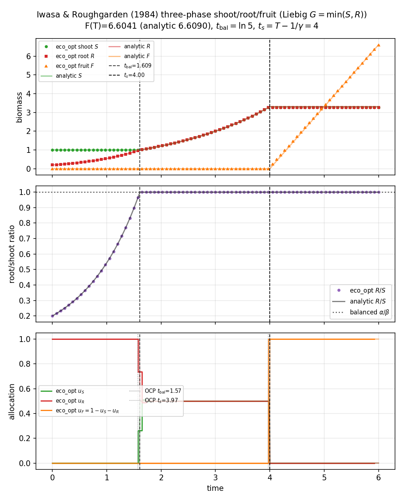

# Iwasa shoot–root–fruit (`iwasa_roughgarden_shoot_root`)

**Question.** How should an annual plant allocate between shoot, root,
and fruit when production is limited by the scarcer vegetative organ?

Here **plant** means that three-organ annual.

## Formulation

| Symbol | Role | Meaning |
|---|---|---|
| \(S,R,F\) | states | shoot, root, fruit |
| two allocation controls | controls | fractions of photosynthate |

**Dynamics** (Liebig production).

\[
G=\min(\alpha S,\beta R),
\]

with \(G\) split among shoot, root, and fruit according to the
controls. Fruit is a sink (no return to \(G\)).

**Objective.** Maximise fruit at the end of a **fixed** season,
\(J=F(T)\).

**Constraints.** Allocations in the unit simplex; non-negative organs;
given \(S(0)\), \(R(0)\), \(F(0)=0\).

## What was done

Two controls on one collocation grid (Radau). The Liebig \(\min\) is
smoothed slightly for the NLP; the closed-form balanced path is the
reference.

## What we found

The OCP recovers the three-phase theorem: balance shoot and root,
stay on the singular balanced arc, then switch to fruit. Analytic
balance time, fruit-switch time, and \(F(T)\) match the numerics.



## Interpretation

Splitting the vegetative body into shoot and root is not a cosmetic
extra state. The hypothesis “maximise terminal fruit with Liebig
production” forces a balanced-growth phase that Cohen’s one-compartment
plant never needs.

## Public API

Full script: `examples/iwasa_roughgarden_shoot_root/shoot_root.py`.

```python
import eco_opt
from eco_opt import Namespace

sys = eco_opt.System(states=3, controls=2, model=shoot_root_model)
ocp = eco_opt.Ocp()
ocp.max(eco_opt.t_f(sys.y.F))
ocp.st(system=sys, constraints=[...])
sol = ocp.solve()
```

## Run and tests

```bash
cd examples/iwasa_roughgarden_shoot_root
python shoot_root.py
python plot_shoot_root.py
python -m pytest ../../tests/test_iwasa_roughgarden_shoot_root.py -q
```

## References

Iwasa and Roughgarden (1984), *Theoretical Population Biology* 25:78–105.
The three-phase **structure** is theirs. The production law here is the
Liebig special case, not their most general concave class.

!!! warning "Not validated against published figures"
    Numerics are checked against the Liebig closed form derived in this
    package, not against figures from Iwasa and Roughgarden (1984).
