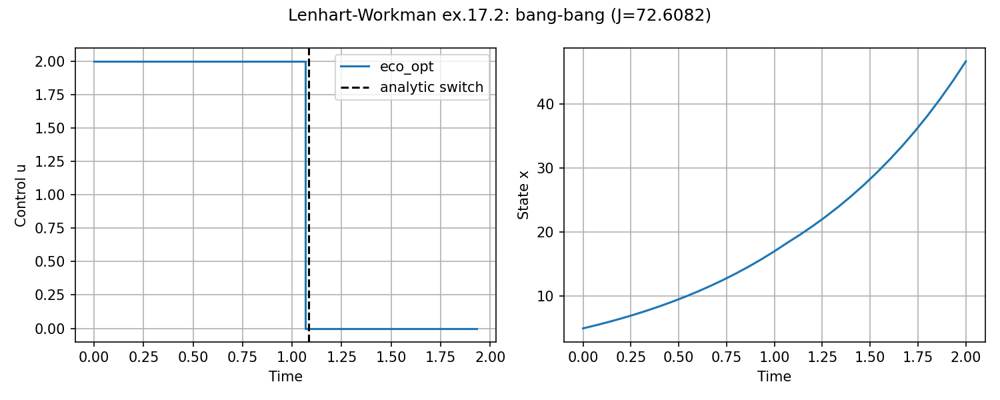
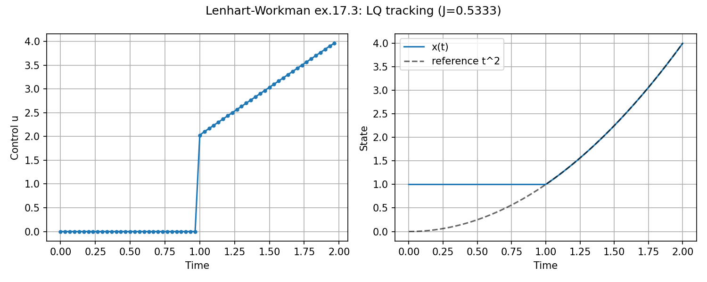
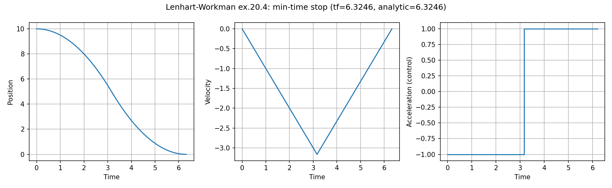

# Lenhart and Workman (`lenhart_workman`)

**Question.** Can the same API recover three textbook OCPs: bang–bang,
smooth tracking, and minimum time?

## Formulation

**17.2 — linear bang–bang.**

\[
\max\int_0^2(2x-3u)\,\mathrm{d}t,\qquad \dot x=x+u,\quad 0\le u\le 2,\quad x(0)=5.
\]

Analytic switch \(t^*=2-\ln 2.5\approx 1.084\).

**17.3 — tracking.**

\[
\min\int_0^2(x-t^2)^2\,\mathrm{d}t,\qquad \dot x=u,\quad 0\le u\le 4,\quad x(0)=1.
\]

Fixed horizon; free terminal state.

**20.4 — min-time trolley.** Double integrator, free \(T\), drive to
rest. Analytic \(T\) from the textbook.

## What was done

Three small `System`/`Ocp` scripts in one folder. Same constraint
tuples as the ecological examples.

## What we found

17.2 recovers the switch. 17.3 is smooth (not bang–bang);
objective regression-tracked. 20.4 matches the analytic \(T\).







## Interpretation

Textbook biology OCPs are small enough that a wrong transcription is
obvious. They are not substitutes for the process-model examples;
they gate bang–bang, tracking, and free time separately.

## Run and tests

```bash
cd examples/lenhart_workman
python linear_bangbang_ex17_2.py
python -m pytest ../../tests/test_lenhart_workman.py -q
```

## References

Lenhart and Workman, *Optimal Control Applied to Biological Models*,
examples 17.2, 17.3, and 20.4.

!!! warning "Not validated against the book’s figures"
    Where the book gives a closed form (switch time, \(T\)), tests
    check that. Trajectories are **not** compared to plotted solutions
    in Lenhart and Workman.
