# Lenhart and Workman labs (`lenhart_workman_labs`)

Thirteen book labs from Lenhart and Workman, *Optimal Control Applied
to Biological Models* (2007), posed in `eco_opt`. The book’s MATLAB
forward–backward sweep is not reproduced. Analytic facts from the
text are used as tests when they exist. Trajectories are **not**
digitized from printed figures.

**How to audit a lab.** For each lab, independently of the MATLAB
codes: (1) copy the ODE, objective, bounds, and the numbered default
case from the PDF; (2) check `max` vs `min` and every sign in \(f\);
(3) if the book gives a closed form, a switch time, a product
invariance (\(A/B\), \(Ak\)), or an untreated trajectory, that is a
test; (4) if the book describes a qualitative shape (front-loaded
\(u\), terminal rebound, bang–bang), that is a test; (5) replay
\(u^{*}\) with `ocp.simulate` if you need to confirm the collocation
tape is an ODE solution. Do not treat agreement with `codeN.m` as
the source of truth — the book text is.

## Lab 1 — Introductory example

**Question.** How does a quadratic penalty on \(u\) trade off against
growing a scalar state?

| Symbol | Role | Meaning |
|---|---|---|
| \(x\) | state | scalar stock |
| \(u\) | control | effort |

**Dynamics.** \(\dot x=-\frac12 x^2+Cu\), \(x(0)=x_0>-2\).

**Objective.** \(\max\int_0^1(Ax-Bu^2)\,\mathrm{d}t\), \(A\ge 0\), \(B>0\).

**Horizon.** Fixed \(T=1\). Default \(A=B=1\), \(C=4\), \(x_0=1\).

**Analytic.** \(A=0\Rightarrow u^{*}\equiv 0\). Trajectories depend
on \(A/B\) only. \(B=0\) and \(A>0\) has no optimum (Exercise 5.1).

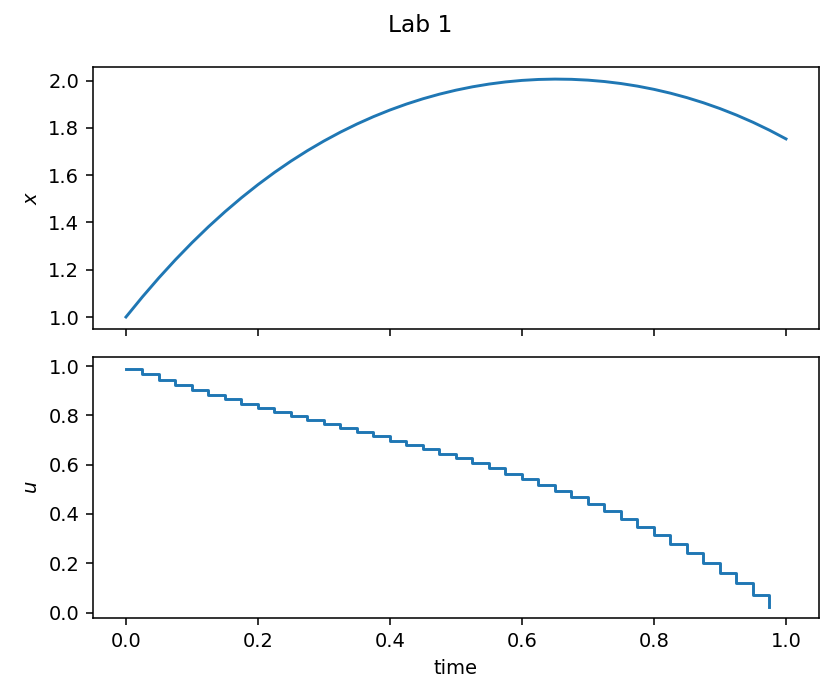

## Lab 2 — Mold and fungicide

**Question.** Schedule fungicide to hold mold down.

**Dynamics.** \(\dot x=r(M-x)-ux\).

**Objective.** \(\min\int_0^T(Ax^2+u^2)\,\mathrm{d}t\). Default
\(r=0.3\), \(M=10\), \(A=1\), \(x_0=1\), \(T=5\). Figure uses \(A=10\).

**Analytic.** Untreated \(x(t)=M+(x_0-M)e^{-rt}\).

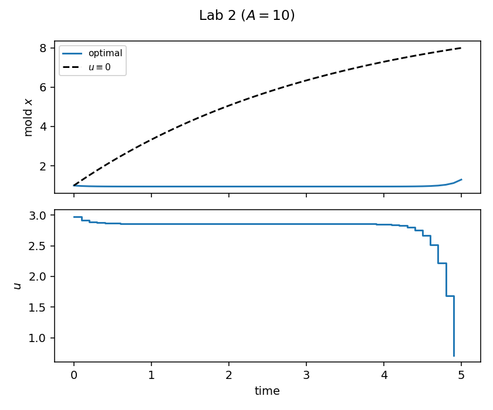

## Lab 3 — Bacteria

**Question.** Add a nutrient that also makes a harmful byproduct.

**Dynamics.** \(\dot x=rx+Aux-Bu^2e^{-x}\).

**Objective.** \(\max Cx(1)-\int_0^1 u^2\,\mathrm{d}t\) (Mayer +
running). Default \(r=A=C=1\), \(B=12\), \(x_0=1\).

**Analytic.** \(A=0\Rightarrow u^{*}\equiv 0\); \(\lambda(1)=C\).

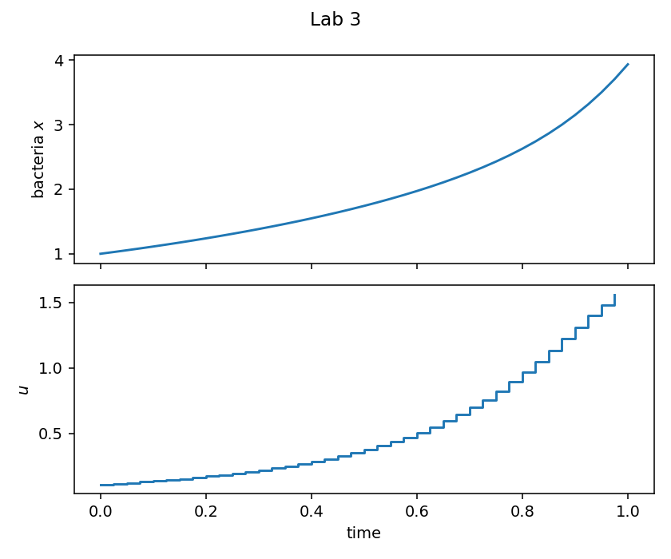

## Lab 4 — Bounded case

Lab 1 with \(B\) scaled out and bounds \(M_1\le u\le M_2\).

Default (9.1): \(A=1\), \(C=4\), \(x_0=1\), \(M_1=-1\), \(M_2=2\)
contains the unbounded Lab 1 solution, so \(u\) is unchanged. Equal
bounds \(M_1=M_2=0\) force \(u\equiv 0\).

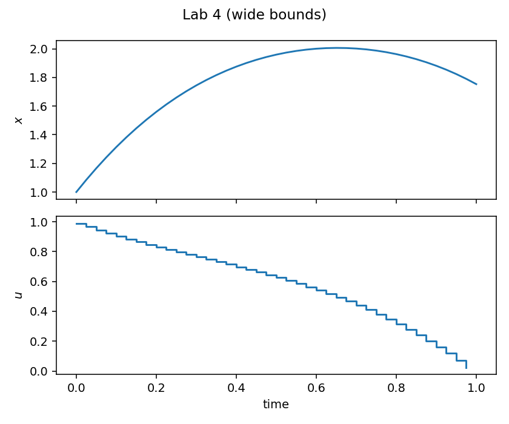

## Lab 5 — Cancer

Skipper log-kill on Gompertz tumor density \(N\in(0,1)\).

**Dynamics.** \(\dot N=rN\ln(1/N)-u\delta N\), \(u\ge 0\).

**Objective.** \(\min\int_0^T(aN^2+u^2)\,\mathrm{d}t\). Default
\(r=0.3\), \(a=3\), \(\delta=0.45\), \(N_0=0.975\), \(T=20\).

**Analytic.** Untreated \(N(t)=N_0^{\mathrm{e}^{-rt}}\). The bound
\(u\ge 0\) is unnecessary for accepted parameters (Exercise 10.2).

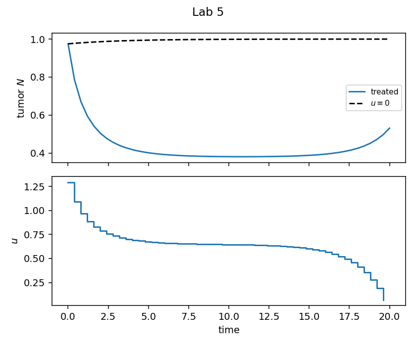

## Lab 6 — Fish harvesting

**Dynamics.** \(\dot x=-(m+u)x\), \(0\le u\le M\).

**Objective.** \(\max\int_0^T\bigl[A\frac{kt}{t+1}xu-u^2\bigr]\,\mathrm{d}t\).
Default \(A=5\), \(k=10\), \(m=0.2\), \(x_0=0.4\), \(M=1\), \(T=10\).

**Analytic.** \(u\equiv 0\Rightarrow x=x_0e^{-mt}\). Controls depend
on the product \(Ak\).

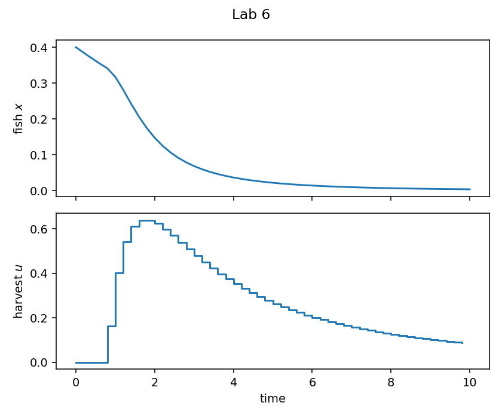

## Lab 7 — Epidemic (SEIR vaccination)

**States.** \(S,E,I,N\) (recovered \(R\) is not needed for the others).

**Control.** Fraction of susceptibles vaccinated, \(0\le u\le 0.9\).

**Objective.** \(\min\int_0^T(AI+u^2)\,\mathrm{d}t\). Default from
the book (13.1), \(T=20\).

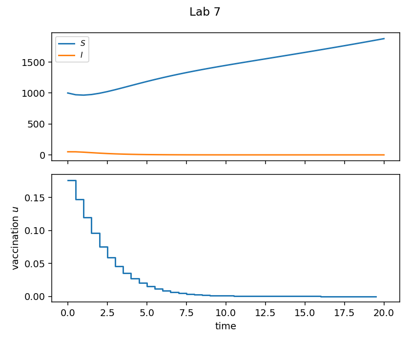

## Lab 8 — HIV treatment

Uninfected \(T\), infected \(T_i\), virus \(V\). Control \(u=0\) is
maximum reverse-transcriptase therapy, \(u=1\) is none.

**Objective.** \(\max\int_0^{T}[AT-(1-u)^2]\,\mathrm{d}t\). Default
(14.1), \(T=20\).

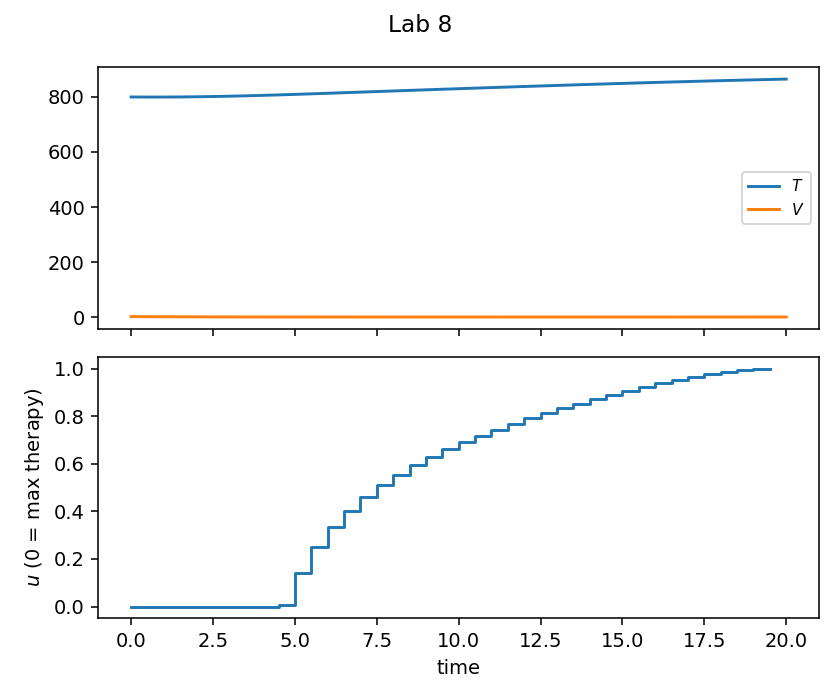

## Lab 9 — Bear populations

Park \(P\), forest \(F\), outside \(O\); harvests \(u_p,u_f\in[0,1]\).

**Objective.** \(\min\int_0^T(O+c_pu_p^2+c_fu_f^2)\,\mathrm{d}t\).
Default \(c_p=10^4\) so park harvest is effectively zero.

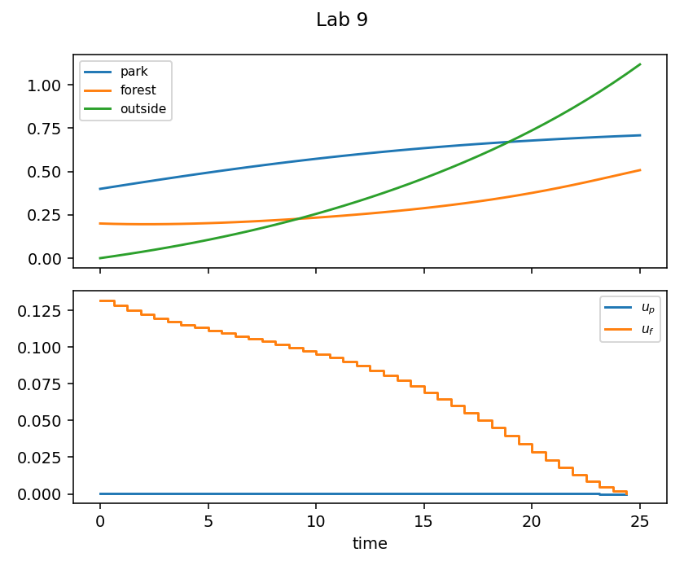

## Lab 10 — Glucose

Linear glucose–hormone model with insulin \(u\).

**Objective.** \(\min\int_0^T\bigl[A(x_1-l)^2+u^2\bigr]\,\mathrm{d}t\).
Default here is the book’s valid GTT window \(T=0.2\) (16.2), not the
ill-conditioned \(T=20\) case.

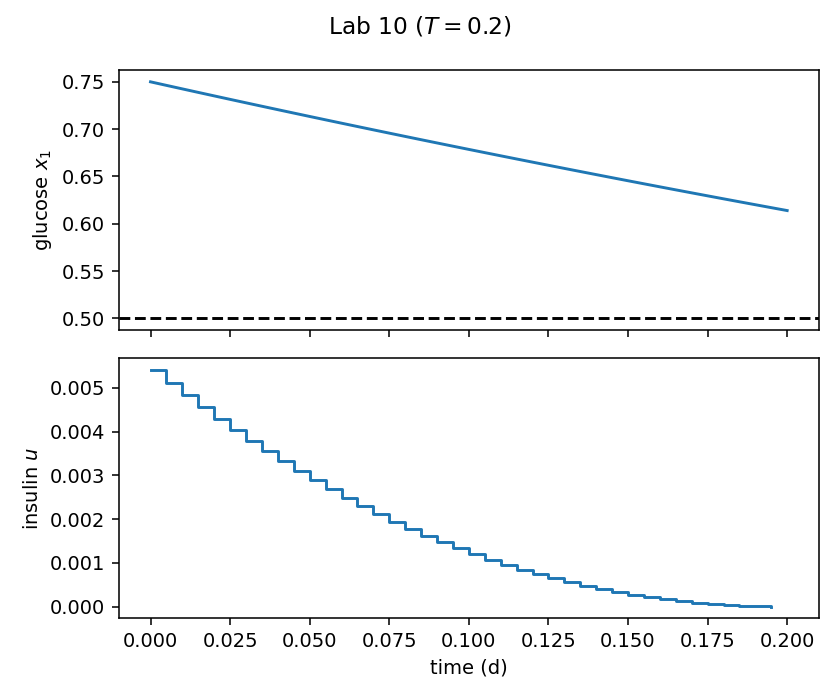

## Lab 11 — Timber harvesting

Linear in \(u\), hence bang–bang.

**Dynamics.** \(\dot x=kxu\), \(0\le u\le 1\).

**Objective.** \(\max\int_0^T e^{-rt}x(1-u)\,\mathrm{d}t\).

**Analytic.** No singular arc. For \(r=0\) the terminal
no-investment interval has length \(1/k\), independent of \(x_0\).
Default \(r=0\), \(k=1\), \(T=5\) switches at \(t^{*}=4\).

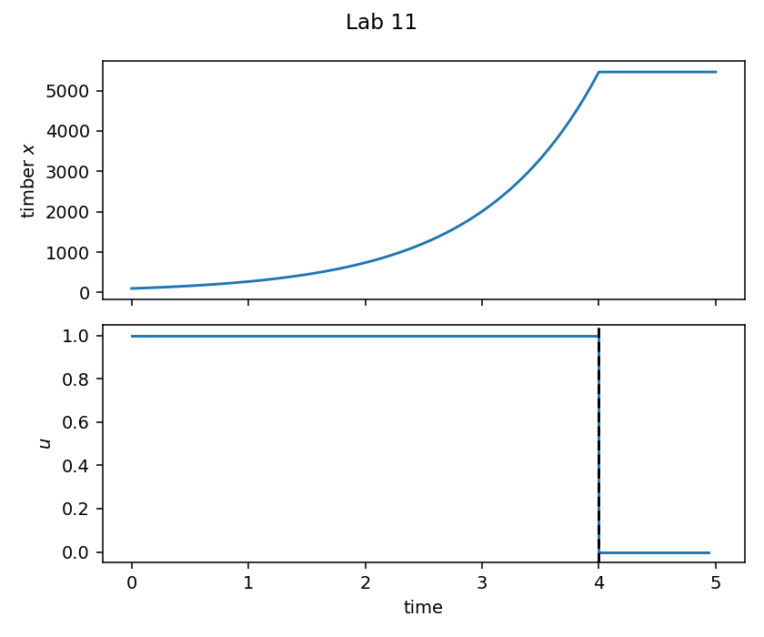

## Lab 12 — Bioreactor

Contaminant \(z\) is eliminated: equivalent problem
\(\max\int_0^T(Kx-u)\,\mathrm{d}t\), \(\dot x=Gux-Dx^2\),
\(0\le u\le M\). Bang–bang. Default \(K=2\) uses no injection;
\(K=2.1\) injects early. Then \(z(t)=z_0\exp(-K\int x)\).

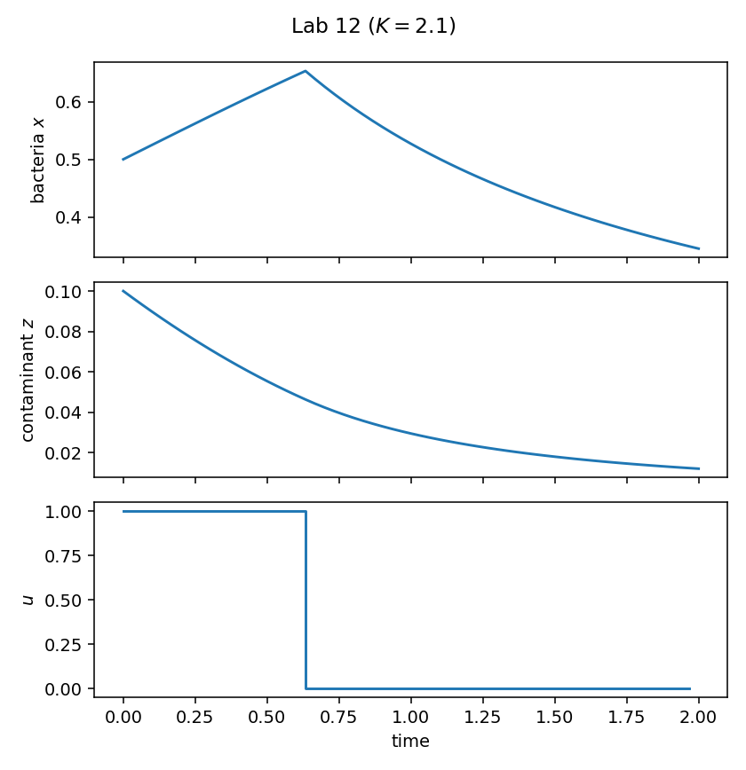

## Lab 13 — Predator–prey pesticide

Lotka–Volterra with pesticide \(u\), box \(0\le u\le M\), and
isoperimetric \(\int_0^T u\,\mathrm{d}t=B\) via an extra state
\(z(0)=0\), \(z(T)=B\).

**Objective.** \(\min N_1(T)+\frac{A}{2}\int u^2\,\mathrm{d}t\).
Default (22.2).

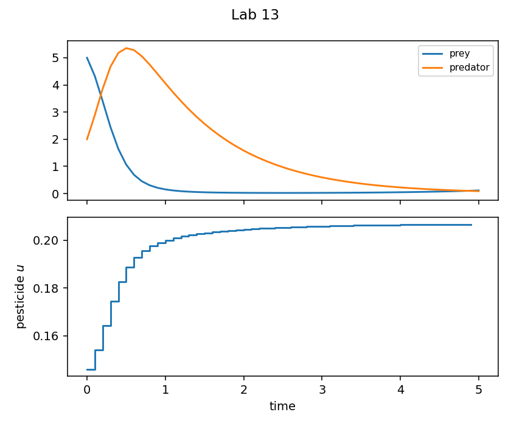

## Run and tests

```bash
cd examples/lenhart_workman_labs
python lab1_introductory.py
python plot_labs.py
python -m pytest ../../tests/test_lenhart_workman_labs.py -q
```

## References

Lenhart and Workman, *Optimal Control Applied to Biological Models*,
Chapman & Hall/CRC, 2007, Labs 1–13. Trajectories are not compared
to the book’s printed figures.
