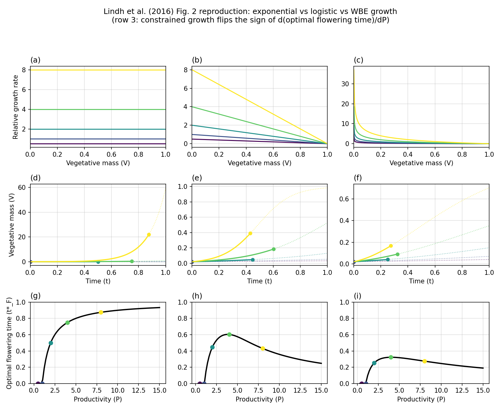

# Lindh flowering (`lindh_2016_flowering`)

**Question.** When should an annual plant switch from vegetative growth
to reproduction, and how does that timing change with productivity
when growth is constrained?

Here **plant** means that phenology model.

## Formulation

| Symbol | Role | Meaning |
|---|---|---|
| \(V(t)\) | state | vegetative biomass |
| \(R(t)\) | state | reproductive biomass |
| \(u(t)\in[0,1]\) | control | fraction of production sent to \(V\) |

**Dynamics.**

\[
\dot V = u\,F(V),\qquad \dot R=(1-u)\,F(V),\qquad F(V)=P\,U(V).
\]

Three \(U\): exponential \(U=V\); logistic; WBE (size-constrained).

**Objective.** \(\max R(T)\). **Horizon.** Fixed season. \(V(0)=V_0\),
\(R(0)=0\).

## What was done

Relaxed \(u(t)\) in \([0,1]\) on one grid. Flowering time is read off
as the switch of \(u^*\). An independent 1-D line search over a single
switch time is the cross-check.

## What we found

The OCP is bang–bang for all three \(U\). Under exponential growth,
optimal flowering time increases with productivity \(P\). Under
constrained growth it can **decrease** — the qualitative result of the
source paper.



## Interpretation

The same allocation ODE plus \(\max R(T)\) is not enough to fix the
sign of \(\mathrm{d}t_F/\mathrm{d}P\). That sign is a property of
\(U(V)\). Constrained growth is a hypothesis about production, not an
extra phenology rule.

## Run and tests

```bash
cd examples/lindh_2016_flowering
python optimal_flowering.py
python -m pytest ../../tests/test_lindh_2016_flowering.py -q
```

## References

Lindh, Johansson, Bolmgren, Lundström, Brännström and Jonzén (2016),
*New Phytologist* 209:1591–1599,
[doi:10.1111/nph.13706](https://doi.org/10.1111/nph.13706).

!!! warning "Not validated against the paper’s figures"
    The `eco_opt` trajectories are **not** checked against the numerical
    results in that paper. The example follows their formulation
    (exponential / logistic / WBE production, \(\max R(T)\)). Tests
    compare the OCP to an independent 1-D line search in this package,
    not to Lindh et al.’s plots.
