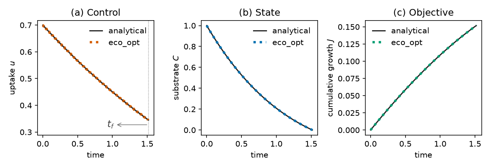
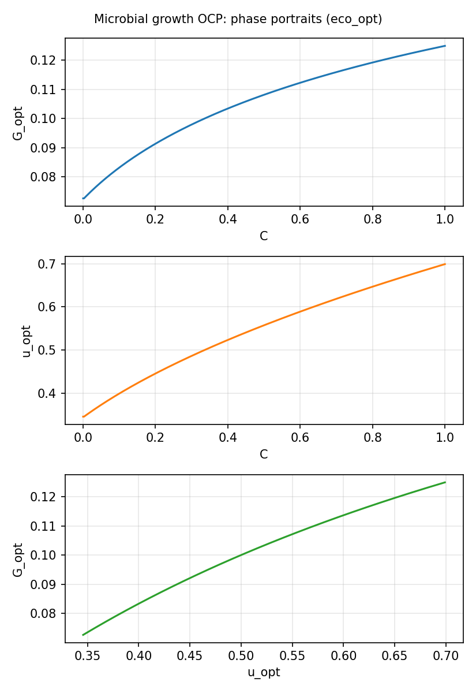
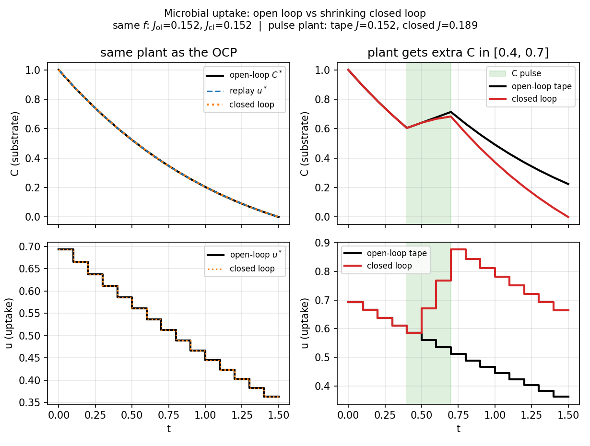

# Microbial growth (`microbial_growth`)

**Question.** How should substrate uptake vary, and when should it stop,
if cumulative growth is maximized while a finite resource is exhausted?

The complete first script and the eco_opt–analytical figure:
[First solve](../first-solve.md).

## Formulation

| Symbol | Role | Meaning |
|---|---|---|
| \(C(t)\) | state | substrate |
| \(u(t)\) | control | uptake rate |
| \(G(u)\) | diagnostic | growth rate |

**Dynamics.**

\[
\dot C = -u - \gamma C + \mu G(u),
\qquad
G(u)=\frac{e_{\max}\beta(u-r)}{u+\beta}-k u.
\]

Baseline: \(\beta=0.5\), \(\gamma=0.5\), \(r=0.1\), \(e_{\max}=0.5\),
\(\mu=0.5\), \(k=0\). First-order decay \(\gamma\) is a **parameter**,
not a control.

**Objective.**

\[
\max_{u(\cdot),\,T}\; J=\int_{0}^{T} G\bigl(u(t)\bigr)\,\mathrm{d}t.
\]

**Constraints.**

\[
C(0)=1,\qquad 0\le C(t)\le 1,\qquad 0\le u(t)\le 10,\qquad T\ge 0.
\]

**Horizon.** Free. The optimizer chooses when continued uptake is no
longer worthwhile.

## What was done

The right-hand side is the process model already used for forward
simulation. Uptake is declared as `u(t)`; \(J\) is the integral of
growth; \(T\) is bounded below by zero. Direct collocation (Radau,
degree 5, 200 intervals) with IPOPT.

## What we found

Solver succeeds; \(C(T)\to 0\) (resource exhaustion); \(C\) and \(u\)
stay in their box bounds. Collocation overlays the independent
analytical trajectories on [First solve](../first-solve.md)
(\(T\approx 1.518\), \(J\approx 0.1518\)). For \(k=0\), \(r>0\),
\(u^*(t)\) is a smooth interior path that declines as \(C\) is depleted.





## Interpretation

A one-pool microbial model does not need a prescribed kinetic rate. An
explicit growth hypothesis plus exhaustion of \(C\) already implies
when uptake should fall and when activity should stop. Changing \(J\)
or the bound on \(u\) would change that schedule; that is the test.

## Open loop vs closed loop

An **open-loop** solve is a single tape \(u^*(t)\) computed from the
model you wrote, then applied from \(t=0\) to \(T\) with no further
looking at \(C\). That is what `ocp.solve` returns. Replaying it with
`ocp.simulate(sol)` integrates the **same** \(\dot C=f(C,u^*)\) and
must reprint \(C^*(t)\).

A **closed loop** (`ocp.closed_loop`) is different: at each sampling
instant it **re-solves** the remaining OCP from the **measured** \(C\),
applies only the first piece of the new \(u^*\), then waits. If the
world is exactly the OCP model, the closed loop reprints the open-loop
tape — there is nothing new to learn. The value appears when the
simulated process is **not** the forecast:

- unexpected extra substrate (a pulse of \(C\) on \([0.4,0.7]\));
- a kinetic parameter that was wrong;
- a horizon that is still running after the plan assumed exhaustion.

Then the tape keeps the old uptake and leaves unused \(C\). The closed
loop sees the extra \(C\), raises \(u\), and captures more growth.

`open_vs_closed.py` pins \(T=1.5\) (the free-\(T\) optimum is about
\(1.52\)) and compares those four runs. Same process: both \(u\) series
match and \(\int G\approx 0.152\). Pulsed process: the tape still uses
the planned uptake and leaves \(C(T)\approx 0.22\) uneaten
(\(\int G\approx 0.152\)); closed loop raises \(u\) after the pulse,
exhausts \(C\), and reaches \(\int G\approx 0.190\).

That gap **is** the reason to close the loop in a process model: the
optimality hypothesis is re-evaluated on the state you actually have,
not on the state you predicted on day zero.



## Public API

Same solve as `examples/microbial_growth/microbial_growth.py`.

```python
import eco_opt
from eco_opt import Namespace

BETA, GAMMA, R, EMAX, MU, K = 0.5, 0.5, 0.1, 0.5, 0.5, 0.0


def growth_rate(u):
    return EMAX * BETA * (u - R) / (u + BETA) - K * u


def microbial_growth_model(t, x, u):
    Cs, uptake = x[0], u[0]
    G = growth_rate(uptake)
    dx = -uptake - GAMMA * Cs + MU * G
    y = Namespace(Cs=Cs, uptake=uptake, growth=G)
    return dx, y


sys = eco_opt.System(states=1, controls=1, model=microbial_growth_model)
ocp = eco_opt.Ocp()
ocp.max([growth_rate(sys.y.uptake)])
ocp.st(
    system=sys,
    constraints=[
        (0, "==", eco_opt.t_0(sys.t)),
        (1, "==", eco_opt.t_0(sys.y.Cs)),
        (0, "<=", eco_opt.t_f(sys.t), "<=", float("inf")),
        (0, "<=", sys.y.Cs, "<=", 1),
        (0, "<=", sys.y.uptake, "<=", 10),
    ],
)
sol = ocp.solve(
    control_intervals=200,
    polynomial_degree=5,
    collocation_points="radau",
    tf_guess=2.0,
)
print(sol.success, sol.tf, sol.objective)
```

## Run and tests

```bash
cd examples/microbial_growth
python microbial_growth.py
python plot_microbial_growth.py
python open_vs_closed.py
python -m pytest ../../tests/test_microbial_growth.py -q
```

## References

Manzoni, Chakrawal and Ledder (2023),
[doi:10.3389/fevo.2023.1094269](https://doi.org/10.3389/fevo.2023.1094269).
This is **not** a Yop website example.
