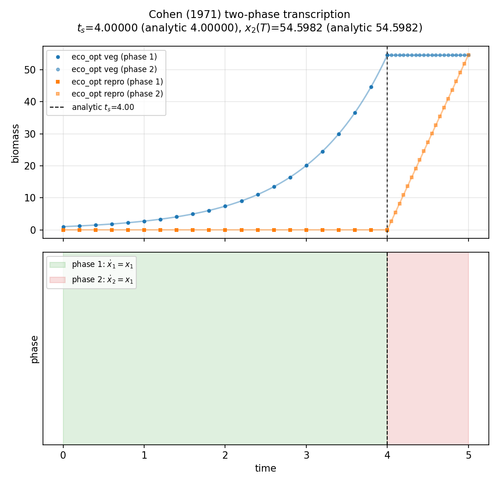

# Multi-phase Cohen (`multiphase_cohen`)

**Question.** Can Cohen’s vegetative-then-reproductive switch be posed
as two sequential phases with a free switch, instead of one jumping
control?

Here **plant** is the same annual-plant model as
[cohen_king_roughgarden](cohen_king_roughgarden.md).

## Formulation

Two phases, **no control**. The bangs are built into each \(f\).

**Phase 1 (vegetative).**

\[
\dot x_1=x_1,\qquad \dot x_2=0.
\]

**Phase 2 (reproductive).**

\[
\dot x_1=0,\qquad \dot x_2=x_1.
\]

**Objective.** \(\max x_2(T)\). **Horizon.** Season \(T\) fixed; switch
time \(t_s\) free. Continuity of time and state at \(t_s\).
\(x_1(0)=X_{10}\), \(x_2(0)=0\).

Analytic: \(t_s^*=T-1\), \(x_2(T)=X_{10}e^{T-1}\).

## What was done

`Phase` objects and `ocp.st(phases=[p1, p2], continuity=True)`. Each
phase has its own `System` and collocation grid.

## What we found

Switch time and yield match the single-phase Cohen closed form (defaults
\(T=5\), \(X_{10}=1\): \(t_s=4\), \(x_2(T)=e^4\)).



## Interpretation

If the biology is “first grow, then reproduce,” that structure can sit
in the **phase graph** rather than in a relaxed \(u(t)\). The optimum
is the same; the decision variable is the switch instant.

## Run and tests

```bash
cd examples/multiphase_cohen
python cohen_two_phase.py
python -m pytest ../../tests/test_multiphase.py -q
```

## References

Cohen (1971). Same biology as the single-phase Cohen example; this
folder tests the `Phase` API.

!!! warning "Not validated against published figures"
    Numerics are checked against Cohen’s closed form, not against
    figures from that paper.
