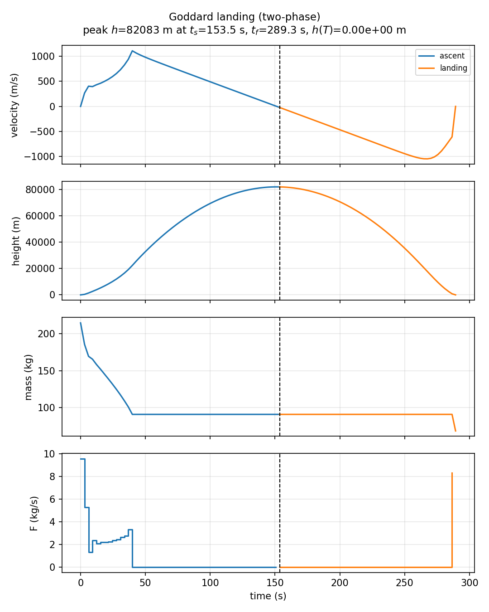
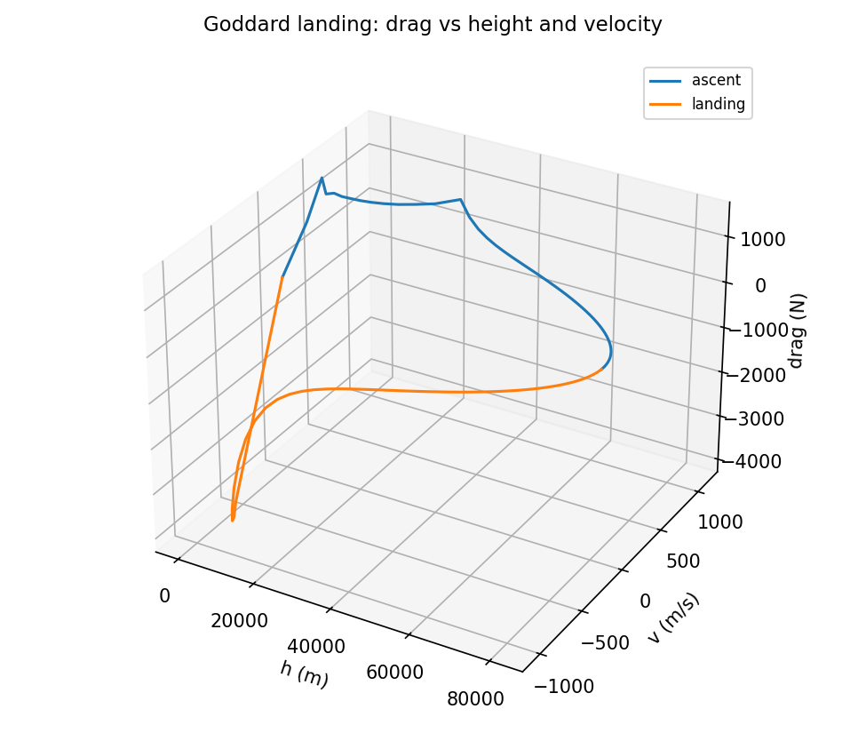

# Goddard landing (`multiphase_goddard_landing`)

**Question.** After maximizing altitude, can a second phase land the
same rocket (\(h=v=0\)) with a free switch and free total time?

Transcription check, not ecology.

## Formulation

**Phase 1.** Same Goddard ascent ODE; maximize altitude; free switch.

**Phase 2.** Same ODE; reach \(h=0\), \(v=0\); free \(T\).

Continuity of time and of \((v,h,m)\) at the junction. Thrust bounds
as in the dimensional vehicle.

## What was done

Two `Phase` objects, `continuity=True`, Radau. Same rocket as
`goddard_benchmark`.

## What we found

A peak altitude near \(8.21\times 10^4\,\mathrm{m}\) then a landing
phase; total \(T\approx 289\,\mathrm{s}\) (regression).





## Interpretation

Multi-phase collocation is for **sequential missions** (or sequential
life-history stages in ecology). The landing bound is a terminal
condition on phase 2, not a path constraint on the whole horizon.

## Public API

Full script: `examples/multiphase_goddard_landing/goddard_landing.py`.

```python
import eco_opt
from eco_opt import Namespace, Phase

sys1 = eco_opt.System(states=3, controls=1, model=goddard_model, name="ascent")
sys2 = eco_opt.System(states=3, controls=1, model=goddard_model, name="landing")
p1 = Phase(sys1, constraints=[...], name="ascent")
p2 = Phase(sys2, constraints=[...], name="landing")
ocp = eco_opt.Ocp()
ocp.max(eco_opt.t_f(sys1.y.rocket.height))
ocp.st(phases=[p1, p2], continuity=True)
```

## Run and tests

```bash
cd examples/multiphase_goddard_landing
python goddard_landing.py
python plot_goddard_landing.py
python -m pytest ../../tests/test_multiphase_goddard_landing.py -q
```

## References

Yop example
[Goddard rocket landing](https://www.yoptimization.com/goddardLanding).
The text and code here are ours.
