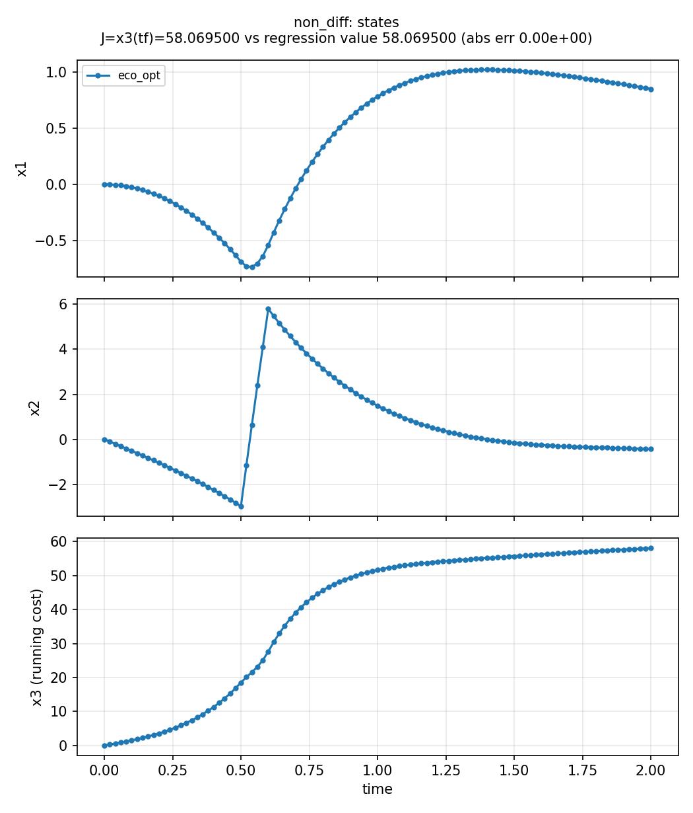
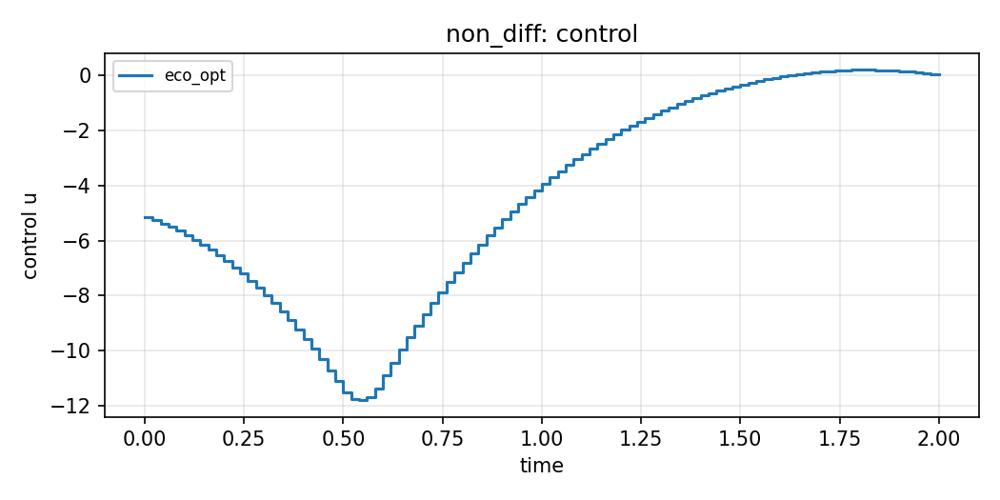

# Nondifferentiable pulse (`non_diff`)

**Question.** Can collocation handle a rectangular pulse in \(f\)
written with `if_else`?

This is a **numerical** pulse, not phenology or ecological regime
switching. The pulse is written with CasADi `if_else` because a
Python `if` cannot branch on symbolic time; see
[Transcription](../transcription.md).

## Formulation

**Dynamics.**

\[
\dot x_1=x_2,\qquad
\dot x_2=-x_1-x_2+u+d(t),\qquad
\dot x_3=5x_1^2+2.5 x_2^2+0.5 u^2,
\]

with \(d(t)\) a pulse of height 100 on \([0.5,0.6]\) via nested
`if_else`.

**Objective.** \(\min x_3(T)\). **Horizon.** Fixed, \(T=2\).
\(\mathbf{x}(0)=\mathbf{0}\).

## What was done

Radau, degree 3, 100 intervals; control guess \(-5\).

## What we found

Solver succeeds. Regression \(J^*\approx 58.07\). The pulse is visible
in \(x_2\).





## Interpretation

A jump in **forcing** is not a jump in the **control**. Bang–bang
allocation (Cohen, Lindh) is a different object. Do not read this
example as a phenology switch.

## Public API

Bare `dx` (`examples/non_diff/non_diff.py`):

```python
import eco_opt


def nondiff_model(t, x, u):
    ...
    return dx


sys = eco_opt.System(states=3, controls=1, model=nondiff_model)
ocp = eco_opt.Ocp()
ocp.min(eco_opt.t_f(sys.x[2]))
ocp.st(system=sys, constraints=[...])
```

## Run and tests

```bash
cd examples/non_diff
python non_diff.py
python plot_non_diff.py
python -m pytest ../../tests/test_non_diff.py -q
```

## References

Yop example
[Nondifferentiable system](https://www.yoptimization.com/nonDiff).
The text and code here are ours.
