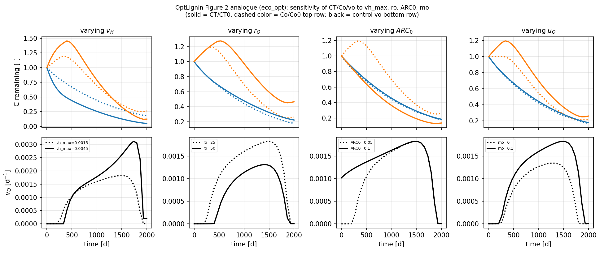
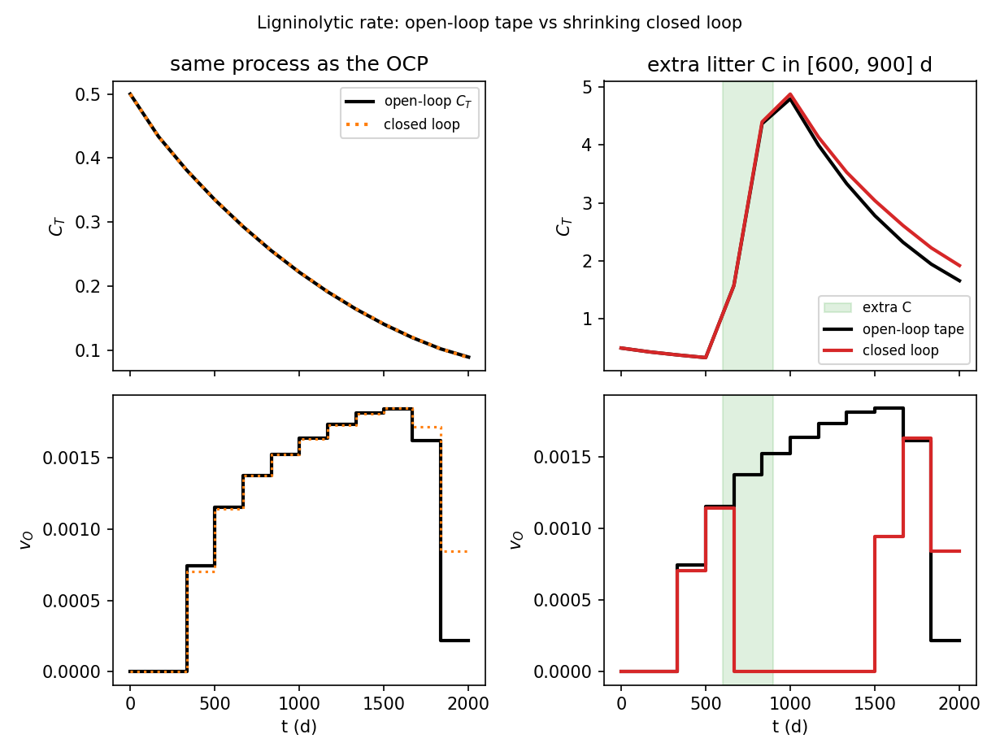

# Ligninolytic investment (`opt_lignin`)

**Question.** Over a fixed decomposition period, when should a
decomposer community pay the carbon cost of oxidising aromatic litter?

## Formulation

| Symbol | Role | Meaning |
|---|---|---|
| \(C_T(t)\) | state | total remaining litter C |
| \(C_O(t)\) | state | aromatic (lignin-derived) C |
| \(v_O(t)\) | control | ligninolytic oxidation rate |
| \(L=C_O/C_T\) | diagnostic | aromatic fraction |

**Dynamics.**

\[
\begin{aligned}
D_H &= v_{H,\max}\,g(L)\,(C_T-C_O),
\qquad
D_O = v_O C_O,\\
e &= e_{\max}-r_O v_O,
\qquad
G = e\,(D_H+D_O),\\
\dot C_T &= -D_H-D_O+G,
\qquad
\dot C_O &= -D_O+\mu_O G,\\
g(L)&=\exp\bigl(-(L/a)^b\bigr).
\end{aligned}
\]

Growth efficiency \(e\) falls linearly with ligninolytic effort.

**Objective.**

\[
\max_{v_O(\cdot)}\; J=\int_0^{T} G(t)\,\mathrm{d}t.
\]

**Constraints.** \(C_T(0)\), \(C_O(0)\) given; \(C_T\ge 0\), \(C_O\ge 0\);
\(0\le v_O\le v_{O,\max}\). Horizon \(T\) **fixed**. Kinetic coefficients
\(v_{H,\max}\), \(\mu_O\), \(r_O\) are pinned parameters.

## What was done

The published process ODE is reused. \(v_O(t)\) is the only control.
Kinetic coefficients are `System` parameters, pinned in `st`.

`lignin_decomposition.py` solves **one** baseline (`ocp.solve`, a new
NLP). The \(r_O\) / \(v_{H,\max}\) / \(ARC_0\) / \(\mu_O\) sweep is
`plot_figure2.py`: `compile_ocp` once, then `apply_scenario` →
`set_constraints` / `optimize` on that mesh
([Build and optimize](../build-optimize.md)).

## What we found

Optimal \(v_O\) is near zero, then rises after a lag and later declines:
hydrolytic substrate is used first. Higher \(r_O\) delays onset and
lowers the peak. Baseline (\(r_O=25\,\mathrm{d}\), litter C:N 50)
gives \(J^*=0.1628\).



## Interpretation

A time-invariant oxidation rate hides the lag. The hypothesis “maximize
growth net of oxidative cost over a fixed incubation” is enough to
produce delayed ligninolysis. That lag is a prediction of the
hypothesis, not an extra switch put into \(f\).

## Open loop vs closed loop

`open_vs_closed.py` replays \(v_O^*\) on the same litter ODE, then on a
process that receives extra litter C in days 600–900. On the forecast
model the shrinking closed loop reprints the tape; printed \(J=\int G\)
is the realized integral along that applied \(v_O\), not
`ClosedLoopResults.objectives[-1]` (that entry is the last remaining-
horizon NLP). After the unforecast C pulse the tape keeps the old
ligninolytic schedule; the closed loop re-solves from the measured
\(C_T\) and can raise \(v_O\). Same lesson as microbial uptake and
irrigation: the hypothesis is unchanged; the **state** from which it
is solved is not.



## Public API

Skeleton of `examples/opt_lignin/lignin_decomposition.py` (RHS and
numeric values in that file):

```python
import eco_opt
from eco_opt import Namespace


def lignin_model(t, x, u, p):
    CT, Co, vo = x[0], x[1], u[0]
    vh_max, mo, ro = p[0], p[1], p[2]
    ...
    y = Namespace(CT=CT, Co=Co, vo=vo, G=G)
    return dx, y


sys = eco_opt.System(states=2, controls=1, parameters=3, model=lignin_model)
ocp = eco_opt.Ocp()
ocp.max([sys.y.G])
ocp.st(system=sys, constraints=[...])
sol = ocp.solve()
```

Frozen-mesh sweep (`plot_figure2.py`):

```python
ocp, sys = compile_ocp()
apply_scenario(ocp, sys, vh_max=..., mo=..., ro=..., ARC0=...)
sol = ocp.optimize(ipopt_options={"max_iter": 2000})
```

## Run and tests

```bash
cd examples/opt_lignin
python lignin_decomposition.py    # baseline, ocp.solve
python plot_figure2.py            # parameter sweep, frozen mesh
python open_vs_closed.py
python -m pytest ../../tests/test_opt_lignin.py -q
```

## References

Chakrawal et al. (2024),
[doi:10.1111/nph.19572](https://doi.org/10.1111/nph.19572).
