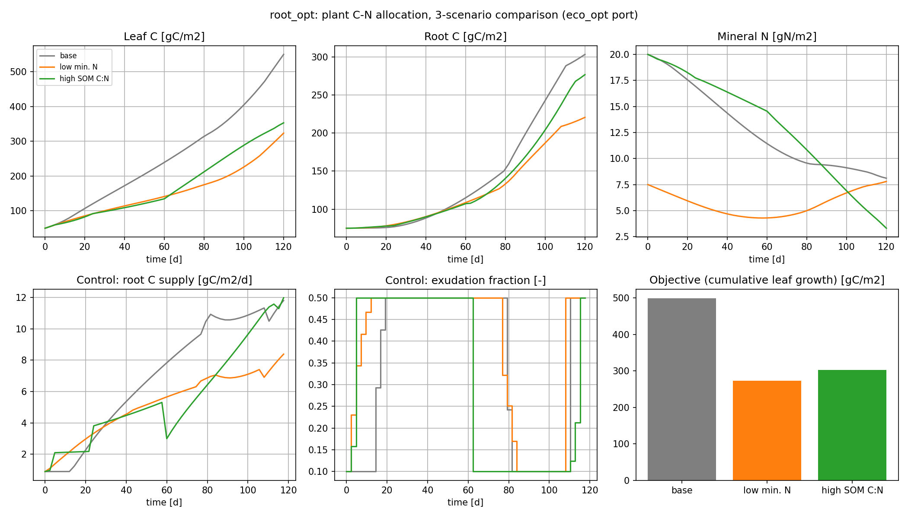
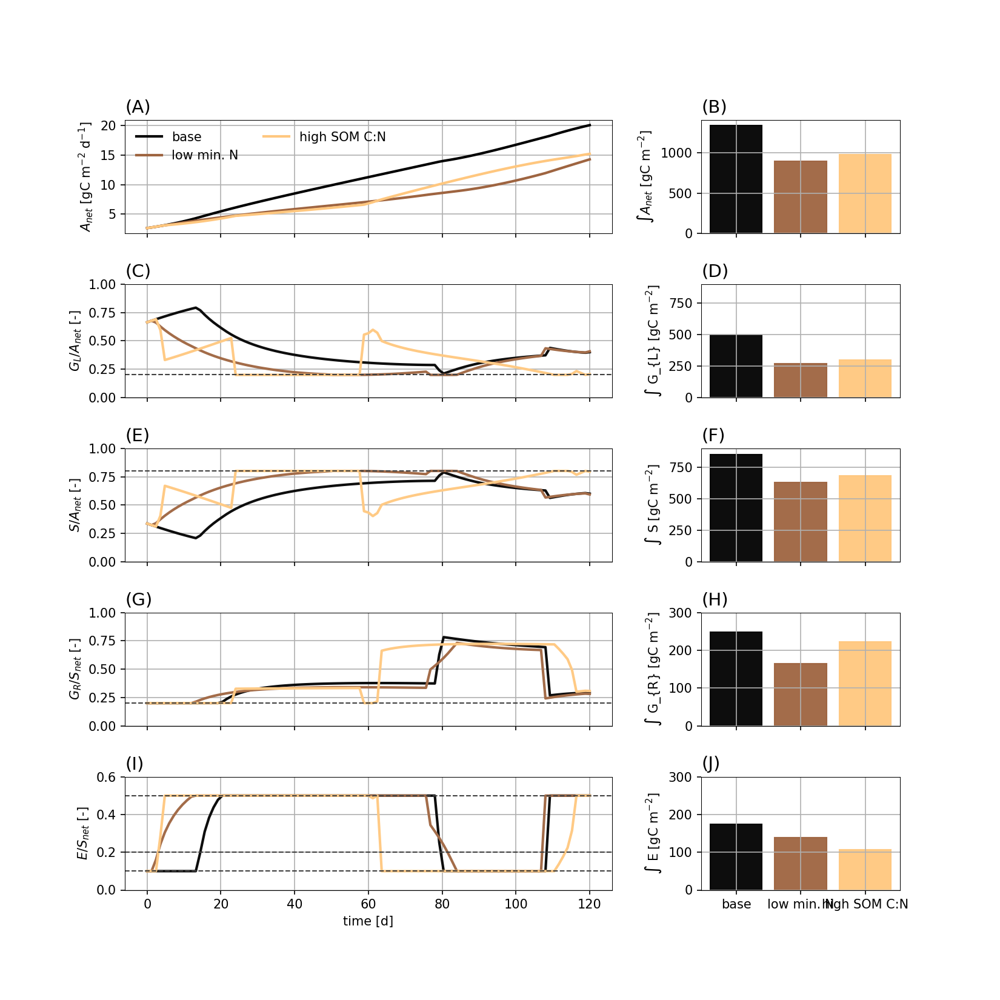
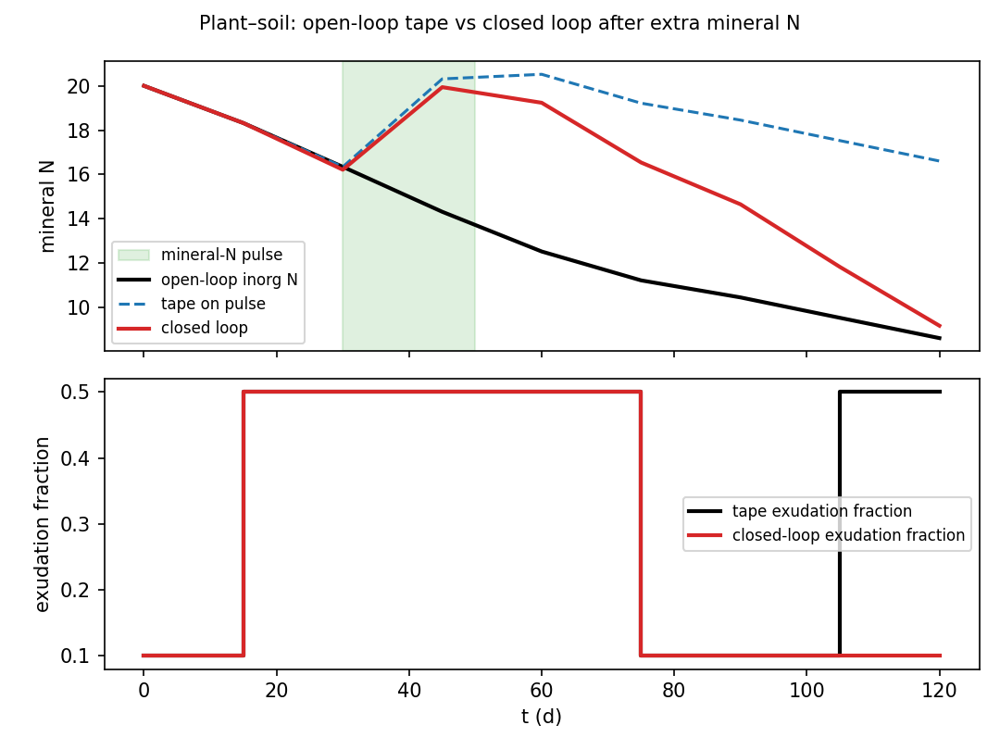

# Plant–soil carbon and nitrogen (`root_opt`)

**Question.** Over a growing season, how should root carbon supply and
exudation be scheduled when nitrogen can be taken up as mineral N or
released by exudation-stimulated mineralisation?

Here **plant** means the vegetation in that coupled model.

## Formulation

| Symbol | Role | Meaning |
|---|---|---|
| nine C and N pools | states | leaf, root, exudate, SOM, microbial, mineral N, … |
| \(S(t)\) | control | root carbon supply |
| exudation fraction | control | share of net root assimilation that is exuded |

**Dynamics.** Published nine-state plant–soil–microbe mass balances
(leaf N diagnosed). Root growth receives what remains of root C after
exudation and maintenance. Microbes take up exudate and SOM;
mineralisation/immobilisation closes microbial N.

**Objective.**

\[
\max_{S(\cdot),\,E(\cdot)}\; J=\int_0^{T} \text{leaf growth rate}\,\mathrm{d}t,
\qquad T=120\,\mathrm{d}.
\]

**Constraints (path).** Exudation fraction in \([0.1,0.5]\); mineral-N
uptake at most capacity; at least 20% of net leaf and root C to growth;
non-negativity.

**Horizon.** Fixed growing season.

## What was done

The published ODE is the `System`. Two controls replace prescribed
allocation fractions. Two initial mineral-N supplies
(\(20\) and \(10\,\mathrm{g\,N\,m^{-2}}\)) are compared.

## What we found

At both N supplies, exudation sits on the upper bound through
mid-season, then declines as more root C goes to root growth. Lower
initial mineral N raises the belowground share of net leaf assimilate
and cuts leaf-C accumulation. \(J^*=499.5\,\mathrm{g\,C\,m^{-2}}\) at
\(20\,\mathrm{g\,N\,m^{-2}}\) and \(322.1\) at \(10\)
(`control_intervals=50`, degree 3).





## Interpretation

Two belowground investments are not a single “exudation rate.” The
hypothesis “maximize leaf growth over the season, with N from roots or
from exudation-stimulated mineralisation” produces an early exudation
phase and a later root-growth phase, and a larger belowground C
commitment when mineral N is scarce. That is a schedule implied by \(J\)
and the bounds, not a calibrated switch.

## Open loop vs closed loop

`open_vs_closed.py` (coarse mesh, \(N=8\)) applies the seasonal tape
to a process that receives extra mineral N in days 30–50. The open-loop
allocation does not see that flush. The shrinking closed loop re-solves
from the measured pools, so exudation and root supply can respond. On
the forecast model, closed loop should reprint the tape — the gap
appears only when the soil is not the forecast.



## Public API

Skeleton of `examples/root_opt/plant_soil_nitrogen_allocation.py`
(nine-state RHS in that file):

```python
import eco_opt
from eco_opt import Namespace


def plant_soil_microbe_nested(t, state, u, params=PARAMS):
    ...
    y = Namespace(leafC=fCL, leaf_growth_rate=leaf_growth, ...)
    return dx, y


sys = eco_opt.System(
    states=9,
    controls=2,
    model=lambda t, x, u: plant_soil_microbe_nested(t, x, u, PARAMS),
)
ocp = eco_opt.Ocp()
ocp.max([sys.y.leaf_growth_rate])
ocp.st(system=sys, constraints=[...])
sol = ocp.solve()
```

## Run and tests

```bash
cd examples/root_opt
python plant_soil_nitrogen_allocation.py
python plot_root_opt.py
python open_vs_closed.py
python reproduce_figures.py
python -m pytest ../../tests/test_root_opt.py -q
```

## References

Chakrawal, Mooney and Colombi (2026), *New Phytologist*
[doi:10.1111/nph.71210](https://doi.org/10.1111/nph.71210).
