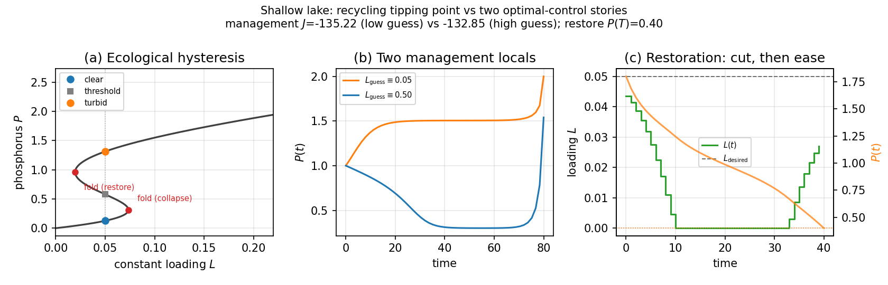

# Shallow lake (`shallow_lake`)

**Question.** How much phosphorus loading should be allowed, and can
two long-run management strategies coexist for the same lake model?

## Formulation

| Symbol | Role | Meaning |
|---|---|---|
| \(P(t)\) | state | water-column phosphorus |
| \(L(t)\) | control | external loading (agriculture) |

**Dynamics.**

\[
\dot P
=
\underbrace{L}_{\text{external loading}}
-
\underbrace{b P}_{\text{export / sedimentation}}
+
\underbrace{\frac{P^{2}}{1+P^{2}}}_{\text{internal recycling}}.
\]

This is the dimensionless recycling of Mäler et al. (2003): the Hill
form \(r P^{q}/(m^{q}+P^{q})\) with \(q=2\), \(m=1\), \(r=1\)
(Carpenter et al. 1999). When \(P\) is small, recycling is weak. When
\(P\) is large, recycling saturates near 1 and keeps the lake dirty.

For \(b=0.52\) and constant loading in a window
(\(L\approx 0.02\)–\(0.07\)) there are **three** equilibria: a stable
clear state, an unstable threshold, and a stable turbid state. At
\(L=0.05\): \(P\approx 0.13\), \(0.58\), \(1.31\).

Raising \(L\) past the upper fold collapses a clear lake to turbid.
Lowering \(L\) back to the collapse value does **not** restore it: you
must go below the lower fold (hysteresis).

**Management OCP** (same \(f\), loading is useful as well as harmful):

\[
\max_{L(\cdot)}
\int_0^{T} e^{-\rho t}
\bigl(
\ln L - c P^{2}
\bigr)\,\mathrm{d}t.
\]

Defaults: \(b=0.52\), \(\rho=0.03\), \(c=1\), \(T=80\), \(P(0)=1\),
\(10^{-3}\le L\le 1.5\).

**Restoration OCP.** Start turbid (\(P(0)=1.8\)), require
\(P(T)\le P_{\mathrm{clean}}=0.4\), stay near a desired long-run
loading \(L_{\mathrm{desired}}=0.05\):

\[
\min_{L(\cdot)}\ \int_0^{T} \bigl(L-L_{\mathrm{desired}}\bigr)^{2}\,\mathrm{d}t.
\]

## What was done

Same `System`; two `Ocp` statements. Management is solved twice from a
**constant** high vs low guess for \(L\) (not a time-varying seed).

## What we found

Two locals of the economic OCP, both `Solve_Succeeded`:

| \(L_{\mathrm{guess}}\) | \(J\) (max) | \(P(T)\) |
|---|---|---|
| \(0.05\) | \(\approx -135.22\) | \(\approx 2.00\) (dirtier) |
| \(0.50\) | \(\approx -132.85\) | \(\approx 1.54\) (cleaner, better \(J\)) |

A true Skiba point (Skiba 1978; Wagener 2003) is an initial \(P\) where
the two **values** are equal. Here the two \(J\)s differ, so these are
two locals, one better.

Restoration: holding \(L\equiv L_{\mathrm{desired}}\) from a turbid
start need not reach \(P_{\mathrm{clean}}\) (hysteresis). The solver
cuts loading hard across the restore fold, then eases toward
\(L_{\mathrm{desired}}\).



## Interpretation

Two different objects share this folder. Do not conflate them.

1. **Ecological tipping point.** Lives in \(\dot P=f(P,L)\) at
   **constant** loading. Clear and turbid states, folds, hysteresis.
2. **Two NLP locals of an OCP.** Lives in the whole problem (objective
   + discounting + \(P(0)\) + bounds). A high vs low **scalar** guess
   for \(L\) is enough to pick which long-run lake the planner manages
   toward.

Initialization is part of the science here: “the solver succeeded” is
not unique. The better \(J\) is the cleaner lake in this parameter
set, but a cold start can still lock onto the dirtier local.

Restoration is the tipping point again: the terminal inequality
\(P(T)\le P_{\mathrm{clean}}\) is not reachable by sitting at the
desired loading if you start turbid.

## Run and tests

```bash
cd examples/shallow_lake
python shallow_lake.py
python plot_shallow_lake.py
python -m pytest ../../tests/test_shallow_lake.py -q
```

## References

Lake ecology: Scheffer et al. (1993); Carpenter, Ludwig and Brock
(1999). OCP with two locals: Mäler, Xepapadeas and de Zeeuw (2003);
Skiba (1978); Wagener (2003).

!!! warning "Not a figure-for-figure reproduction"
    The `eco_opt` trajectories are **not** validated against the
    numerical figures of those papers. The example follows their
    formulation; quantitative agreement with their plots is not claimed.
