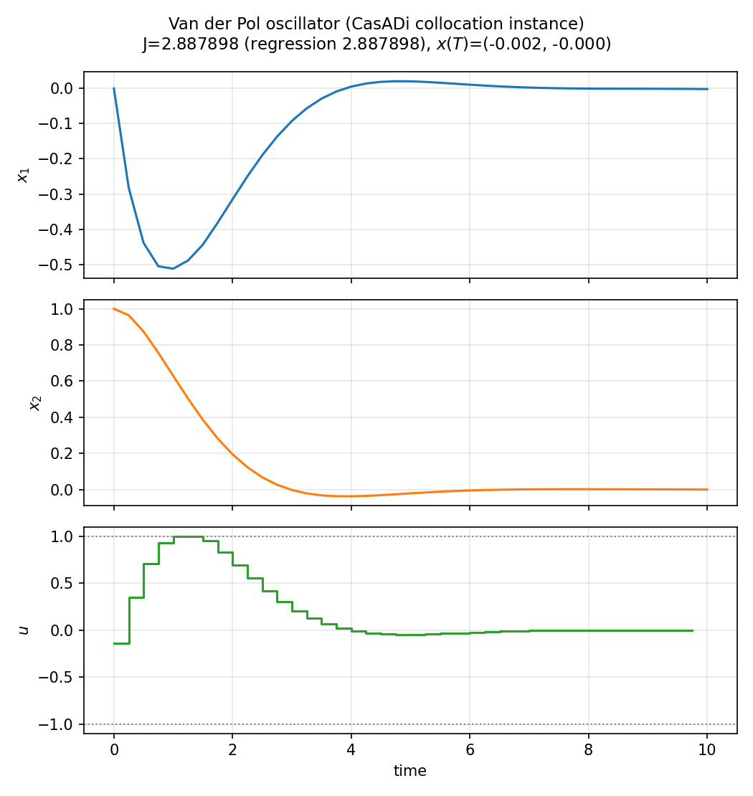

# Van der Pol (`van_der_pol`)

**Question.** How does collocation behave on a smooth nonlinear
oscillator with a quadratic running cost and box bounds on the control?

## Formulation

Unforced Van der Pol is \(\ddot x-\mu(1-x^2)\dot x+x=0\). Here a
control enters as a force; \(J\) is a quadratic running cost on state
and control over a **fixed** horizon, with box bounds on \(u\).

No closed-form \(J\).

## What was done

Standard collocation instance used as a nonlinear Lagrange gate (the
role this oscillator plays in many toolboxes).

## What we found

Solver succeeds. Regression \(J^*\approx 2.888\).



## Interpretation

A smooth oscillator with a running cost is a different test from
bang–bang allocation or a free horizon. Failure here would be a
collocation bug, not an ecological finding.

## Run and tests

```bash
cd examples/van_der_pol
python van_der_pol.py
python -m pytest ../../tests/test_van_der_pol.py -q
```
