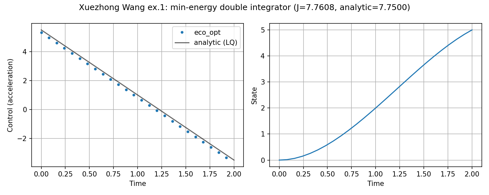
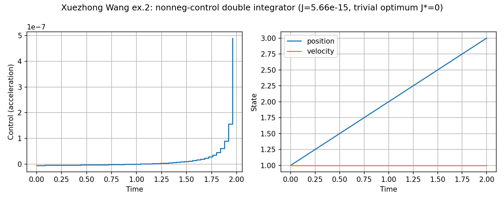

# Double integrator, Wang (`xuezhong_wang`)

**Question.** Fixed-horizon double-integrator problems with and without
a sign restriction on the control.

## Formulation

**Ex. 1 — unconstrained energy.**

\[
\min\int_0^2 \tfrac12 a^2\,\mathrm{d}t,\qquad
\dot x=v,\;\dot v=a,\quad
(x,v)(0)=(0,0),\; (x,v)(2)=(5,2).
\]

Closed form \(a^*(t)=-4.5 t+5.5\), \(J^*=7.75\).

**Ex. 2 — nonnegative control.** \(a\ge 0\),
\((x,v)(0)=(1,1)\), \(x(2)=3\), \(v(2)\ge 0\). Optimum \(u^*=0\),
\(J^*=0\).

**Horizon.** Fixed, \(T=2\).

## What was done

Two scripts; same integrator chain as Bryson–Denham but **fixed** \(T\)
and no path bound on \(x\).

## What we found

Ex. 1 matches \(J^*=7.75\). Ex. 2 is the trivial zero-control solution.





## Interpretation

A sign restriction on \(u\) can collapse the problem (here to “do
nothing”). That is a constraint effect, not a failure of collocation.

## Run and tests

```bash
cd examples/xuezhong_wang
python bryson_denham_fixed_tf.py
python -m pytest ../../tests/test_xuezhong_wang.py -q
```

## References

Wang, *Solving optimal control problems* (fixed-time LQ and nonnegative
control variants).

!!! warning "Not validated against that note’s figures"
    Numerics are checked against the closed forms stated in the note,
    not against its plots.
