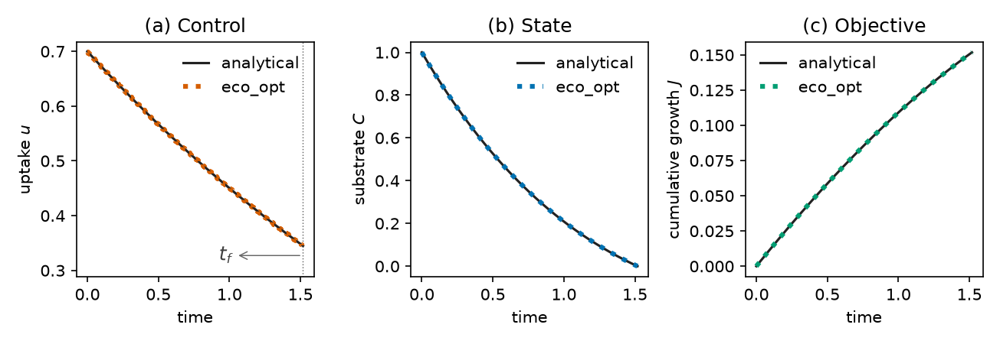

# First solve

Finite-substrate microbial growth: maximise cumulative growth while a
resource pool is exhausted. The horizon \(T\) is free. The script below
is complete. Formulation, closed loop, and further figures:
[Microbial growth](examples/microbial_growth.md).

If IPOPT fails, see [Troubleshooting](troubleshooting.md). For what
counts as a state, a control, or a cost, see
[Posing a problem](posing.md).
The control is piecewise constant on the collocation mesh; see
[Transcription](transcription.md).
Time bounds are written explicitly in `st`
([Constraints and time](constraints-and-time.md)).

This right-hand side uses only `+`, `-`, `*`, `/`, so there is no
`import casadi`. Named signals are a `Namespace`
([CasADi expressions](casadi-expressions.md)). A list of derivatives
is stacked by `System`; a one-state model may return a scalar.

```python
import eco_opt
from eco_opt import Namespace

BETA, GAMMA, R, EMAX, MU, K = 0.5, 0.5, 0.1, 0.5, 0.5, 0.0


def growth_rate(u):
    return EMAX * BETA * (u - R) / (u + BETA) - K * u


def microbial_growth_model(t, x, u):
    Cs, uptake = x[0], u[0]
    G = growth_rate(uptake)
    dx = -uptake - GAMMA * Cs + MU * G
    y = Namespace(Cs=Cs, uptake=uptake, growth=G)
    return dx, y


sys = eco_opt.System(states=1, controls=1, model=microbial_growth_model)
ocp = eco_opt.Ocp()
ocp.max([growth_rate(sys.y.uptake)])
ocp.st(
    system=sys,
    constraints=[
        (0, "==", eco_opt.t_0(sys.t)),
        (1, "==", eco_opt.t_0(sys.y.Cs)),
        (0, "<=", eco_opt.t_f(sys.t), "<=", float("inf")),
        (0, "<=", sys.y.Cs, "<=", 1),
        (0, "<=", sys.y.uptake, "<=", 10),
    ],
)
sol = ocp.solve(
    control_intervals=200,
    polynomial_degree=5,
    collocation_points="radau",
    tf_guess=2.0,
)
print(sol.success, sol.tf, sol.objective)
```

Same solve as a module: `examples/microbial_growth/microbial_growth.py`.
That command writes the comparison figure and prints its path:

```bash
cd examples/microbial_growth
python microbial_growth.py
```

`sol.success` should be true. This mesh gives \(T\approx 1.518\) and
\(J\approx 0.1518\). How to read `sol` and plot with matplotlib:
[Results and plots](results-and-plots.md).

The figure compares collocation (thick dotted) to an independent
analytical solution (solid): control, substrate, and cumulative
growth, with \(t_f\) marked on the control panel.


