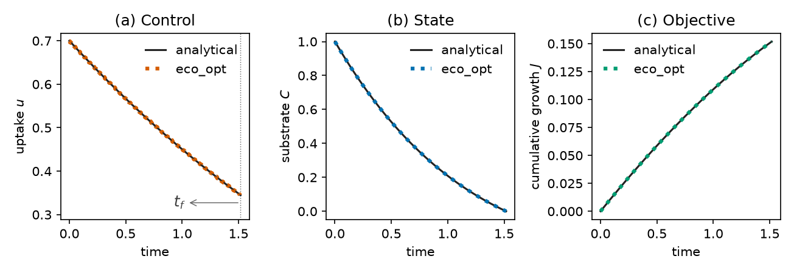

# eco_opt

`eco_opt` is a Python package for turning a process-based ODE into a
constrained optimal-control problem and solving it by direct collocation.

The process right-hand side is supplied by the user. Controls
(quantities the modeler lets vary in time to improve \(J\)), the
performance criterion, and constraints are declared. The package
transcribes that statement with CasADi and solves it with IPOPT, and
returns the optimal controls, the states, and the
[shadow prices](shadow-prices.md) of the states.

The modeling workflow follows [Yop](https://www.yoptimization.com)
(Leek, 2016). `eco_opt` is a Python implementation of that workflow, not
a copy of the Yop documentation. When an example here is a transcription
of a Yop-shipped case, the example page links to the corresponding Yop
page.



## A complete solve

Microbial uptake of a finite substrate pulse: maximize cumulative growth
while the substrate is lost at rate \(\gamma\) and partly recycled as
necromass. The final time is free. Explanation:
[First solve](first-solve.md).

```python
import eco_opt
from eco_opt import Namespace

BETA, GAMMA, R, EMAX, MU = 0.5, 0.5, 0.1, 0.5, 0.5


def growth_rate(u):
    return EMAX * BETA * (u - R) / (u + BETA)


def model(t, x, u):
    Cs, uptake = x[0], u[0]
    dx = -uptake - GAMMA * Cs + MU * growth_rate(uptake)
    return dx, Namespace(Cs=Cs, uptake=uptake)


sys = eco_opt.System(states=1, controls=1, model=model)
ocp = eco_opt.Ocp()
ocp.max([growth_rate(sys.y.uptake)])
ocp.st(
    system=sys,
    constraints=[
        (0, "==", eco_opt.t_0(sys.t)),
        (1, "==", eco_opt.t_0(sys.y.Cs)),
        (0, "<=", eco_opt.t_f(sys.t), "<=", float("inf")),
        (0, "<=", sys.y.Cs, "<=", 1),
        (0, "<=", sys.y.uptake, "<=", 10),
    ],
)
sol = ocp.solve(control_intervals=200, polynomial_degree=5, tf_guess=2.0)
print(sol.success, sol.tf, sol.objective)   # True, T ~ 1.518, J ~ 0.1518
```

## Soil and plant–soil applications

<div class="grid cards" markdown>

-   **[Microbial uptake](examples/microbial_growth.md)**

    One state, one control, free final time. Benchmarked against the
    analytical solution of Manzoni et al. (2023).

-   **[Ligninolytic investment](examples/opt_lignin.md)**

    Two litter pools, one control, fixed decomposition period
    (Chakrawal et al., 2024).

-   **[Plant–soil C and N allocation](examples/root_opt.md)**

    Nine pools, two allocation controls, and physiological limits
    (Chakrawal et al., 2026).

</div>

More ecological models and textbook problems: [Examples](examples/index.md).

## Start here

1. [Install](install.md)
2. [First solve](first-solve.md) — microbial growth (finite substrate)
3. [Results and plots](results-and-plots.md) — `sol` arrays and matplotlib
4. [Shadow prices](shadow-prices.md) — marginal values of the states
5. [Posing a problem](posing.md) — states, controls, costs
6. [CasADi expressions](casadi-expressions.md) — `cs.exp`, `if_else`, interpolants in the model
7. [Transcription](transcription.md) — piecewise-constant \(u\), collocation, mesh
8. [Constraints and time](constraints-and-time.md) — boxes, path, \(t_0\)/\(t_f\), horizon
9. [Guesses, mesh, scaling](guesses-mesh-scaling.md) — cold start, mesh, units
10. [Build and optimize](build-optimize.md) — frozen mesh, bound and parameter sweeps
11. [Examples](examples/index.md) — ecological models, then textbook OCPs
12. [Troubleshooting](troubleshooting.md)
13. [API](api.md)

## What it is for

Process models in ecology are usually integrated forward: given the
process equations and inputs, stocks (state variables) are predicted.
Some of those inputs or rates can be treated as controls. `eco_opt`
asks what trajectory is implied by an explicit optimality hypothesis
and the same process equations, subject to constraints.

The same workflow applies to populations, water, greenhouse climate,
biogeochemistry, and other process-based ecological ODEs — not only
carbon allocation or organism physiology.

It does not claim that the system maximizes the chosen objective. A
numerical solution shows that the hypothesis is internally consistent
with the dynamics and constraints.

## Cite

See [Cite](cite.md). Also cite CasADi, IPOPT, and Yop for the numerical
stack and modeling workflow.
