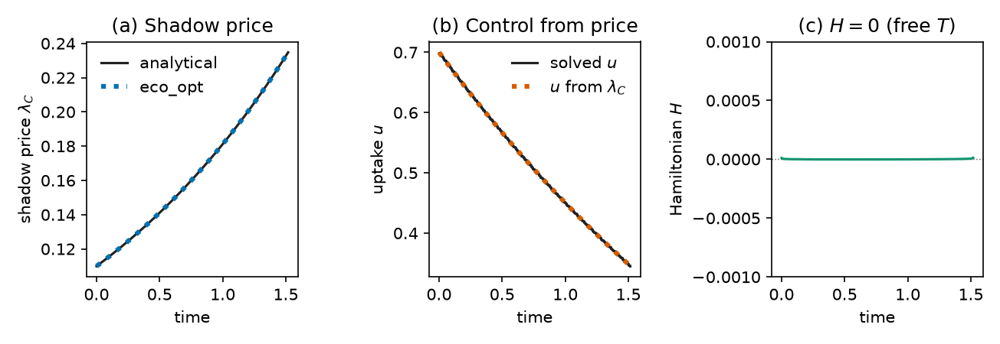

# Shadow prices

A single-phase solution returns, alongside the optimal controls and
states, an estimate of the **costate** \(\lambda(t)\) of each state and
the **Hamiltonian** \(H\). This page explains what these quantities
mean, how to read them, and how to check them.

## What they are

For an optimal-control problem with running payoff \(L\), dynamics
\(\dot x = f(x,u,t)\), and terminal payoff \(M\), Pontryagin's maximum
principle introduces one costate \(\lambda_i(t)\) per state and the
Hamiltonian

\[
H = L(x,u,t) + \lambda^\top f(x,u,t).
\]

Along a smooth optimum, the costate of state \(i\) equals the
sensitivity of the optimal objective to that state,

\[
\lambda_i(t) = \frac{\partial J^*}{\partial x_i(t)},
\]

that is, the change in \(J^*\) per extra unit of state \(i\) at time
\(t\), with the rest of the trajectory re-optimized. In economics and
ecology this quantity is called a **shadow price**: the marginal value
of a pool. Optimal rates change through time because these values
change as pools are depleted, replenished, or approach the end of the
period.

`eco_opt` does not derive costate equations. It recovers \(\lambda\)
from the multipliers of the collocation equations of the discretized
problem, a standard property of direct collocation
([Benson et al., 2006](https://doi.org/10.2514/1.20478);
[Garg et al., 2010](https://doi.org/10.1016/j.automatica.2010.06.048)).

## Getting them

```python
lam = sol.costate          # (N*d, nx), lambda = dJ/dx, declared sense
t_lam = sol.costate_time   # (N*d,), collocation-point times
H = sol.hamiltonian        # (N*d,), H = L + lambda' f
```

- **Sign.** The sign follows the declared objective. For
  `ocp.max(...)`, a positive \(\lambda_i\) means one more unit of
  state \(i\) raises \(J\); for `ocp.min(...)`, a positive
  \(\lambda_i\) means it raises the cost.
- **Grid.** Values sit on the collocation points, not on `sol.time`.
  Use `np.interp(sol.time, t_lam, lam[:, i])` if another grid is
  needed.
- **Multi-phase problems** set `costate`, `costate_time`, and
  `hamiltonian` to `None`.

## Reading them

- **End of the period.** With a free final state and no terminal
  payoff, \(\lambda(t_f) = 0\): a pool left at the end has no value.
  With a terminal payoff, \(\lambda(t_f) = \partial M/\partial x\).
- **Hamiltonian.** For dynamics and running payoff without explicit
  time dependence, \(H\) is constant along an optimum, and \(H = 0\)
  when the final time is free. A drifting \(H\) signals an inaccurate
  solution.
- **Controls that enter \(H\) linearly**, such as allocation
  fractions. Only the sign of \(\partial H/\partial u\) matters: the
  control sits at its upper bound while \(\partial H/\partial u > 0\)
  and at its lower bound while \(\partial H/\partial u < 0\).
  \(\partial H/\partial u = \partial L/\partial u + \lambda^\top
  \partial f/\partial u\) can be evaluated from `sol.costate` and the
  model. `scripts/manuscript/fig_box2_lignin.py` computes
  \(\partial H/\partial v_O\) at \(v_O = 0\) in this way for the
  ligninolytic-investment model.
- **Active constraints.** Where a path or state constraint is active,
  the constraint rather than the shadow price determines the control,
  and the costate may jump or oscillate between collocation points.

## Example: microbial uptake of a finite substrate

In the [microbial-growth example](examples/microbial_growth.md), the
shadow price of substrate rises as
\(\lambda(t) = \lambda_T e^{\gamma (t - T)}\): substrate becomes more
valuable as it runs out. The optimal uptake follows from the price,
\(u = -\beta + \sqrt{e_{max}\beta(r+\beta)(\mu + 1/\lambda)}\), so a
rising \(\lambda\) means slowing uptake. The figure compares the
`eco_opt` estimate with the analytical solution of
[Manzoni et al. (2023)](https://doi.org/10.3389/fevo.2023.1094269).



```bash
cd examples/microbial_growth
python plot_microbial_growth.py   # writes figs/microbial_growth_costate.png
```

## Checking them

When no analytical solution exists, check the shadow price at \(t = 0\)
against a finite difference: perturb the initial state, re-solve, and
compare \(\Delta J^*/\Delta x_0\) with \(\lambda(0)\). With `build`
and `optimize`, only the initial-state bound changes between solves
([Build and optimize](build-optimize.md)).

```python
import numpy as np
import eco_opt
from eco_opt import Namespace

BETA, GAMMA, R, EMAX, MU = 0.5, 0.5, 0.1, 0.5, 0.5


def growth_rate(u):
    return EMAX * BETA * (u - R) / (u + BETA)


def model(t, x, u):
    Cs, uptake = x[0], u[0]
    G = growth_rate(uptake)
    return -uptake - GAMMA * Cs + MU * G, Namespace(Cs=Cs, uptake=uptake)


sys = eco_opt.System(states=1, controls=1, model=model)
ocp = eco_opt.Ocp()
ocp.max([growth_rate(sys.y.uptake)])
ocp.st(
    system=sys,
    constraints=[
        (0, "==", eco_opt.t_0(sys.t)),
        (1, "==", eco_opt.t_0(sys.y.Cs)),
        (0, "<=", eco_opt.t_f(sys.t), "<=", float("inf")),
        (0, "<=", sys.y.Cs, "<=", 2),   # room above C(0) = 1 for the perturbation
        (0, "<=", sys.y.uptake, "<=", 10),
    ],
)
ocp.build(control_intervals=200, polynomial_degree=5, collocation_points="legendre")
sol = ocp.optimize(tf_guess=2.0)

# Shadow price at t = 0: extrapolate from the first two collocation points.
(t1, t2), (l1, l2) = sol.costate_time[:2], sol.costate[:2, 0]
lam0 = l1 - (l2 - l1) / (t2 - t1) * t1


def J_at(C0):
    ocp.set_constraints([(C0, "==", eco_opt.t_0(sys.y.Cs))])
    return ocp.optimize(tf_guess=2.0).objective


h = 1e-4
fd = (J_at(1 + h) - J_at(1 - h)) / (2 * h)
print(f"lambda(0) = {lam0:.5f}, finite difference = {fd:.5f}")
```

Expected output: `lambda(0) = 0.10989, finite difference = 0.10989`.
The same idea checks interior times: re-solve the remaining horizon from
\(x^*(t_k)\) with a perturbed state and compare with \(\lambda(t_k)\)
(Bellman's principle).

`tests/test_costate.py` checks the costate against:

- the closed-form microbial solution, for Legendre and Radau points;
- one- and two-state linear-quadratic problems, including the Riccati
  solution \(\lambda = P(t)\,x(t)\) and a constant Hamiltonian;
- a problem with a terminal payoff only, where \(\lambda\) is the
  terminal gradient;
- finite-difference sensitivities \(\partial J^*/\partial x\) of the
  two-state lignin model at \(t = 0\) and at interior times.

## Limitations

- Single-phase problems only.
- Accuracy follows the mesh; refine it if the costate is noisy.
- IPOPT finds local optima. A shadow price describes the optimum that
  was found.
- A shadow price is conditional on the model and the objective. It
  describes the value of a pool under the stated optimality
  hypothesis, not a measured property of organisms.
